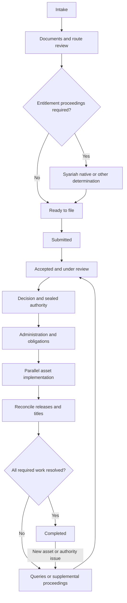

# Malaysian Inheritance Workflows — Research and App Design Map

Research/access date: **11 October 2026**. This directory contains 16 comparable jurisdiction maps based on the project files and sequential web research. It is a research specification with explicit verification gates, not a claim that every registry’s current practice has been confirmed.

**FACT** identifies sourced findings. **INFERENCE** identifies proposed product/workflow reasoning. **UNKNOWN — Not found / needs verification** identifies an unresolved question and its verification owner. A publication accessed in 2026 is not necessarily a 2026 rule. Historic schedules, failed direct fetches and indexed-only findings are identified in each Sources list. Government guidance sometimes contains obsolete thresholds or ambiguous boundaries; those conflicts are retained rather than silently reconciled.

## Index

- [Johor](johor.md)
- [Kedah](kedah.md)
- [Kelantan](kelantan.md)
- [Melaka](melaka.md)
- [Negeri Sembilan](negeri-sembilan.md)
- [Pahang](pahang.md)
- [Perak](perak.md)
- [Perlis](perlis.md)
- [Pulau Pinang](pulau-pinang.md)
- [Sabah](sabah.md)
- [Sarawak](sarawak.md)
- [Selangor](selangor.md)
- [Terengganu](terengganu.md)
- [Kuala Lumpur](kuala-lumpur.md)
- [Putrajaya](putrajaya.md)
- [Labuan](labuan.md)

Each file includes the eleven requested sections, four numbered case flows with Mermaid diagrams, document and fee tables, local exceptions, digital channels, baseline differences, design implications and section-level confidence. Shared asset rules are consolidated below; each file also includes an institution-by-institution checklist.

## Baseline read and comparison method

The local root description is [estate-unlock-project.md](../estate-unlock-project.md). The actual directory is uppercase `PDF/`; it contains one PDF, [Malaysia estate unlock complete case workflow.pdf](../PDF/Malaysia%20estate%20unlock%20complete%20case%20workflow.pdf). All 14 pages were read before research. Both local sources were accessed on 2026-10-11.

The app is intended to guide families from intake through real asset release, with bilingual explanations, deterministic routing/share calculations, document preparation, dispute referral and an evidence-based tracker. AI extraction/explanation should support, rather than decide, legal entitlement. The project’s initial Peninsular MVP scope is narrower than this requested 16-jurisdiction research set.

The PDF uses Prepare (15%), Route (10%), File (15%), Review/hearing (20%), Grant (15%) and Transfers (25%). Its generic strengths are heir/asset discovery, debts and prior rights, completeness checks, linked successive deaths, reopening omitted assets and refusing completion without release evidence. Its jurisdiction-specific machinery includes Act 98, MyLand/Form A/Form P, specified orders and Peninsular land transmission. Sabah and Sarawak are expressly deferred. Federal Territory coverage needs refinement for Labuan.

The research corrects or qualifies blanket exclusion of nominated assets, universal joint survivorship, all insurance being outside the estate, conflation of lifetime hibah and one-third wasiat, automatic High Court routing for every dispute, universal mandatory-lawyer wording, universal RM10 stamping and an overbroad inherited-property acquisition-value shortcut. Unverified PDF deadlines, hardcopy requirements and fee statements are not promoted to confirmed 2026 requirements.

## Comparison matrix

The timeline column describes **published targets or general guidance**, not measured average completion times. “JKPTG 4–6 months” is national processing guidance subject to backlog and excludes subsequent land/bank implementation. Digital maturity is an **INFERENCE**: “Partial” means separate portals/forms exist; “Broader partial” means more named transaction/status services were found. Neither implies end-to-end integration or public APIs. Confidence is overall; fee/timeline confidence is usually lower. Local evidence is linked through the jurisdiction name.

| Jurisdiction | Syariah court process | Small estate threshold / route | Typical timeline / available target | Digital maturity (inference) | Confidence |
| --- | --- | --- | --- | --- | --- |
| [Johor](johor.md) | Single/layered orders; local directions | ≤RM5m, Act 98; will/religion screen | JKPTG 4–6 months; other stages unknown | Partial; local scope uncertain | Medium |
| [Kedah](kedah.md) | PK-JKSNK-10; older witness rule needs reconciliation | ≤RM5m, Act 98; will/religion screen | JKPTG 4–6 months; other stages unknown | Partial; local scope uncertain | Medium |
| [Kelantan](kelantan.md) | Certificate route; current local pack missing | ≤RM5m, Act 98; will/religion screen | JKPTG 4–6 months; other stages unknown | Partial; local scope uncertain | Low |
| [Melaka](melaka.md) | Single/layered forms; historic gazetted certificate fees | ≤RM5m, Act 98; will/religion screen | JKPTG 4–6 months; other stages unknown | Partial; local scope uncertain | Medium |
| [Negeri Sembilan](negeri-sembilan.md) | Court-tier criteria need reconciliation; customary land | ≤RM5m, Act 98; will/religion screen | JKPTG 4–6 months; other stages unknown | Partial; local scope uncertain | Medium |
| [Pahang](pahang.md) | Conditional FAWiHA accelerated route | ≤RM5m, Act 98; will/religion screen | Eligible FAWiHA same day/7 days; JKPTG 4–6 months | Partial; local scope uncertain | Medium |
| [Perak](perak.md) | 2018 courts enactment; 2023 order-fee items | ≤RM5m, Act 98; will/religion screen | JKPTG 4–6 months; other stages unknown | Broader partial | Medium |
| [Perlis](perlis.md) | Certificate route; residue/radd verification | ≤RM5m, Act 98; will/religion screen | JKPTG 4–6 months; other stages unknown | Partial; local scope uncertain | Medium |
| [Pulau Pinang](pulau-pinang.md) | Faraid/munasakhat directions; first mention ≠ certificate | ≤RM5m, Act 98; will/religion screen | JKPTG 4–6 months; other stages unknown | Broader partial | Medium |
| [Sabah](sabah.md) | Local estate/heir orders; 2026 reform commencement unknown | Local Cap. 1; current ceiling UNKNOWN; no imported RM5m | No verified statewide end-to-end SLA | Partial; local scope uncertain | Medium |
| [Sarawak](sarawak.md) | Local ordinances; certificate pack needs verification | Cap. 80 Probate Officer; no verified JKPTG RM5m route | District targets only; no verified statewide total | Broader partial | Medium |
| [Selangor](selangor.md) | JAKESS forms; 2026 reform commencement check | ≤RM5m, Act 98; will/religion screen | Faraid certificate 14 days after decision; JKPTG 4–6 months | Broader partial | Medium |
| [Terengganu](terengganu.md) | Local courts enactment; current pack missing | ≤RM5m, Act 98; will/religion screen | JKPTG 4–6 months; other stages unknown | Partial; local scope uncertain | Low |
| [Kuala Lumpur](kuala-lumpur.md) | MSWP 311; MS3/MS26 | ≤RM5m, Act 98; will/religion screen | JKPTG 4–6 months; other stages unknown | Broader partial | Medium |
| [Putrajaya](putrajaya.md) | MSWP 311; local registry allocation | ≤RM5m, Act 98; will/religion screen | JKPTG 4–6 months; other stages unknown | Broader partial | Medium |
| [Labuan](labuan.md) | MSWP; High Court note above RM50,000 | Act 98 with Labuan modifications; RM5m national ceiling, local operation to confirm | JKPTG 4–6 months; other stages unknown | Broader partial | Low |

## Shared routing rules and evidence checks

| Claim | Evidence and cross-check | Research decision |
| --- | --- | --- |
| Current Act 98 ceiling and asset scope | Current JKPTG FAQ plus MyGovernment March 2026 guidance [N1] [N2] [N4] | FACT: ≤RM5m at application; movable-only, immovable-only or mixed. Non-Muslim will changes routing. Do not apply to Sabah/Sarawak automatically |
| Reform date | Current Act text mirror records A1643 commencement 15 July 2024; government guidance reflects the new scope [N28] [N1] | FACT with official-consolidation gap: old RM2m pages are obsolete; verify current rules and later directions |
| ARB summary ceiling | MyGovernment summary guide and agency categories, corroborated by ARB’s older statutory checklist [N6] [N4] [N31] | FACT: national movable-only summary category ≤RM600k; local statutory/asset acceptance still needs verification in eastern jurisdictions. ARB’s wider administration role is separate |
| Small-estate order fee | Current JKPTG FAQ; older JKPTG pages mention only the lower band [N1] | FACT: current FAQ quotes 0.2% below RM2m, 0.3% RM2,000,001–RM5m. UNKNOWN: exact RM2m boundary, fractional-ringgit treatment and rounding; obtain operative Rule 18 schedule. No independent current second fee source secured |
| Small-estate time | JKPTG FAQ [N1] | FACT: 4–6 months stated, expressly backlog-dependent. Not measured state medians, not final asset release; no independent local SLA corroboration |
| Sabah local ordinances | Sabah AGC commencement index and JTU statutory-authority page [sabah6] [sabah4] | FACT: repeal/extension text must not be confused with commencement; local jurisdiction remains a separate branch |
| Sarawak Probate Officer | Cap. 80 official text and Kuching/Sibu administrative pages [sarawak7] [sarawak8] [sarawak5] | FACT: identify the officer and category, including Kuching’s special allocation; not automatic Peninsular probate |
| Labuan civil probate | Reproduced 2020 judgment plus official judiciary docket [labuan7] [labuan11] | FACT about that decision; UNKNOWN current exhaustive legislative position. Block automatic Act 97 routing pending registry review |
| Local fees | Melaka fee regulations, Perak 2023 rules, Perlis 2024 land rules, Kedah/PTGWP tables [melaka1] [perak2] [perlis2] [kedah3] [labuan3] | Treat as specific published items with age/fetch qualifications; most lack a second independently current source. Obtain a complete quotation |

INFERENCE: Route by **deceased + asset + jurisdiction + operative law**, not by the applicant’s selected state alone. One estate can have several land registries, foreign grants, special asset claims and linked deaths. Store both jurisdiction of administration and location of each asset. A consented family arrangement requires valid authority and protection of minors/incapacitated persons; it is not an app-level override of entitlement.

For current JKPTG cases, its FAQ directs applicants according to asset location and requires formal written correction of a submitted application rather than editing it in place. The hearing notice is available through email/MyLand. Applicant attendance, another entitled heir, DDA for eligible absent heirs and guardian attendance need explicit checklist tasks. Do not infer that an online submission removes an oath/original-document requirement. [N1] [N3]

## Asset claims

These are parallel asset workstreams, not six new estate jurisdictions. There is no separate “EPF versus KWSP” branch: they name the same institution. Each claim must preserve the institution’s reference, authorised recipient capacity, amount, evidence and any residual duty to distribute.

| Institution | Claim path and documents | Evidence gate / exception |
| --- | --- | --- |
| EPF/KWSP | Use the current death-withdrawal checklist and KWSP 9KM (AHL), death/ID, bank and relationship/representation evidence. With a valid nomination, identify nominee capacity; without one, ask EPF for the applicable staged-payment/authority requirements [N10] | Muslim nominee generally administers as wasi; non-Muslim nominee generally benefits. EPF describes a one-year claim condition for Muslim nominations made from 1 January 2017. Check nomination date/status and current exceptions; do not replace this with a universal limitation period for all estates [N11] |
| ASNB/ASB | T1 estate claim, identity/death and relationship/authority documents. The October 2025 brochure describes a simplified eligible near-kin route at ≤RM10,000; above that seek accepted authority [N12] | FAQ distinguishes ordinary faraid certificates from accepted Sabah/Sarawak orders and separate hibah-amanah arrangements. Confirm the precise order and eligible recipient/fund account. A hibah service is not a generic nomination [N13] |
| Tabung Haji | Ordinary death closure uses JP005; JP006 applies to the relevant indemnity/consent route; hibah claims use the separate JP035 procedure [N14] | JP005 specifies RM5 closure charge or the lower balance. Its no-nomination treatment distinguishes balances above RM1,000 from the small-balance undertaking route. Reconfirm current form before a quote [N15] |
| THiJARI | Some death-claim withdrawals are supported online subject to claimant/account eligibility [N16] | Inactive/bankrupt/minor and specified account/status situations require branch handling. Online availability ≠ every case eligible |
| Banks | Notify the institution and obtain its exact deceased-account checklist. Maybank Malaysia’s account terms contemplate a grant/LA or equivalent legal document for individual-account death handling [N18] | No universal small-balance waiver, release fee or timeline verified. Joint-account operational payment clauses do not by themselves prove final beneficial entitlement; obtain the mandate and ownership evidence |
| Life insurance | Claim form, death/policy/claimant identity and nominee/assignment evidence; insurer may require additional cause-of-death evidence | LIAM distinguishes beneficiary from executor nomination. Examine policy, nominee relationship and statutory trust status; do not assume every nomination is beneficial or every policy is estate property [N17] |
| Takaful | Obtain operator’s claim pack and nomination/conditional-hibah election and acceptance | FACT: the operator form offers executor or conditional-hibah beneficiary elections and refers to IFSA s142/Schedule 10. UNKNOWN: the particular policy’s valid election, claim fee and SLA. [N34] The FSA/IFSA framework and actual instrument must be checked. Never label all takaful nominees as beneficiaries or all as administrators |
| Labuan financial-centre product | Check product regulator, trust/policy instrument and recognised authority | Act 704 has its own insurance-payment provisions; territorial residence alone does not classify the product [labuan12] |

INFERENCE: Asset states should be `discovered → ownership/nomination_verified → authority_required_or_exception_confirmed → claim_submitted → institution_query → approved → paid_or_registered → reconciled`. Preserve receipts and distinguish payment to an administrator from final payment to beneficiaries. Record mortgage/security discharge and insurer-to-lender payments before calculating distributable equity. JPJ, securities registrars and unclaimed-money claims should be additional adapters; their current detailed forms/fees were not fully audited here.

## Fees and tax

FACT: Filing, certificate issuance, order fees, representative registration, beneficiary transfer, search/copy/oath, stamp duty and professional administration charges are different line items. A council’s wasiat-writing price is not a court filing fee; a foreign-interest approval exemption is not free registration; a fee for replacing a lost title is not the estate-transmission tariff. State files identify these distinctions.

FACT: Finance (No. 2) Act 2023 amended Stamp Act item 32(h), including qualifying renunciation between beneficiaries of the same estate, effective 1 January 2024. The RM10 treatment is instrument-specific; a purchase, sale, non-beneficiary transfer or other arrangement needs its own assessment. The enacted-amendment source was identified through official indexed text; its direct PDF fetch failed. The complete 2026 amendment audit and instrument-specific assessment remain verification tasks. [N21]

FACT: HASiL’s inherited-property guidance differentiates acquisition by an executor from acquisition by a beneficiary. The deceased-to-executor and executor-to-beneficiary events must be separately recorded; death-date market value is not a universal basis for a beneficiary’s later disposal. HASiL’s stamp self-assessment rollout is phased from 2026. Check the instrument category and current MyTax/stamping instructions, rather than assuming all real-property instruments entered the first phase. [N19] [N20]

UNKNOWN: Most courts/land offices do not provide a verified current all-inclusive estate price or observed median in the sources retrieved. Display “quote required” rather than zero, and show the effective date and charging unit (per title, order, layer, application or copy) for every published item. Do not present the 2019 ARB tier table or timelines as a 2026 quote. [N31]

FACT: The judiciary’s indexed register describes a 30-day hearing-listing target for uncontested High Court in Malaya probate/LA cases under Direction 3/2009, marked active there. Current registry implementation and grant-issue time require verification. This is separate from JKPTG’s processing guidance. [N35]

## Unified status model

INFERENCE — an EMGS-style model that preserves the PDF skeleton while separating legal authority from operational completion:

| Status | Owner | Entry / exit evidence | Divergence |
| --- | --- | --- | --- |
| `DRAFT_INTAKE` | Applicant | Death report and consent to create case; exit when basic identity and inventory available | Multiple deaths create linked case IDs |
| `DOCUMENTS_REQUIRED` | Applicant / assisting professional | Versioned checklist, missing item, who must supply it | Originals, residence, native/community or will evidence differ |
| `ROUTE_REVIEW` | Rules engine + human reviewer | Religion, domicile, asset locations/values, will, native/customary status, existing cases; recorded rule/source/version | Sabah/Sarawak/Labuan and uncommenced reforms may require manual authority confirmation |
| `ENTITLEMENT_PENDING` | Syariah / native / other competent authority | Case receipt, rights disputes and required determination; exit on accepted order or documented not-required decision | Faraid need is conditional; sepencarian/hibah/custom can create parallel cases |
| `READY_TO_FILE` | Applicant / representative | Validated current pack, fee estimate and selected receiving office | ARB engagement and local district packs differ |
| `SUBMITTED` | Filing party | Portal/counter receipt with submission ID and date | A drafted application cannot trigger this status |
| `ACCEPTED_FOR_PROCESSING` | Receiving authority | Acceptance/case number; deficiency tasks resolved or tracked | Submitted does not automatically mean accepted |
| `REVIEW_OR_HEARING` | Deciding authority and participants | Notice, attendance/consent, valuation and requisition history | Court, JKPTG, Collector, Probate Officer or native forum |
| `DECIDED_AWAITING_INSTRUMENT` | Issuing authority / payer | Decision, assessed fee, pending sealed instrument | Local certificate/order targets start from the correct event |
| `AUTHORITY_ISSUED` | Registry / authorised representative | Sealed grant/order, schedule, representative powers and verification | Certificate alone may be insufficient for a given asset |
| `ADMINISTRATION_IN_PROGRESS` | Representative | Asset collections, creditor/tax tasks, settlement evidence and accounts | Nominee claims may run earlier where legally permitted |
| `ASSET_IMPLEMENTATION` | Land office / bank / institution | One subcase per asset, accepted instrument, claim/query/payment/title evidence | Local land laws, native title, nomination and product terms |
| `RECONCILIATION` | Representative / beneficiaries | Net estate, receipts, balances and protected minor/trust shares | Payment to representative is not final distribution |
| `COMPLETED` | Case reviewer | All in-scope assets resolved, obligations accounted for, no unresolved required follow-up | Long-running trusts may be closed as a documented handoff, not a fictitious payout |
| `REOPENED_OR_SUPPLEMENTAL` | Applicant / competent authority | New asset, changed representative, corrected order or other legally sufficient trigger | Form P only where appropriate; local/court amendment elsewhere |

Use orthogonal flags for `AWAITING_APPLICANT`, `AWAITING_AUTHORITY`, `DISPUTED`, `STAYED`, `ON_APPEAL`, `WITHDRAWN`, `REJECTED`, `FOREIGN_RECOGNITION_REQUIRED` and `LAW_VERIFICATION_REQUIRED`. Record reason, responsible party, next action and resumption event. A dispute is not a progress percentage; nor is it necessarily a transfer to a different jurisdiction.

Suggested data entities: deceased; death event; person/relationship; heir eligibility at each death; estate case; asset/ownership interest; liability; nomination/hibah; authority proceeding; document/version; fee assessment; status event/evidence; consent; representative/guardian; distribution entitlement; payment/registration. Keep estimated shares separate from adjudicated shares. Preserve audit history when estate values or heir evidence change.

Show a stage indicator and completed evidence tasks rather than an apparently precise legal completion percentage. If the PDF weights are used for a demo, label them product estimates, recalculate for skipped branches, and require asset-level evidence before 100%.

## Digital integration plan

INFERENCE: Start with official deep links, current form-pack versioning, applicant-uploaded acknowledgements, reminders and manual authority updates. Potential partners are JKPTG/MyLand, each Syariah department, ARB, land registries, JPN/JPPH and financial institutions. No public API contract or permission to access private case data was established. A calculator, court staff system or online-payment page is not proof of an integration interface. No general MyEG inheritance endpoint was found.

Prioritise a read-only status pilot with one confirmed authority and a small number of supported asset institutions. Store status provenance (`authority_verified`, `receipt_extracted`, `applicant_reported`) and the relevant case ID. Keep original-document and attendance tasks visible where necessary. An external agency’s response time must not be inferred from our app’s upload timestamp.

FACT: MyGovernment describes eSyariah V3 status/appointment coverage except Sarawak. The Kelantan-specific listing describes viewing one’s own cases, but does not explicitly identify faraid coverage. These findings support a status-link opportunity, not a claim that the app can file or retrieve cases through an open API. [N33] [kelantan6]

## Recent reforms and currentness register

| Development | Evidence | Implementation treatment |
| --- | --- | --- |
| RM5m and movable-only small-estate expansion | Current JKPTG/MyGovernment; A1643 commencement recorded 15 July 2024 [N1] [N2] [N28] | Active federal rule within verified territorial scope |
| Cancellation of older JKPTG estate circulars | Official notice says effective 13 January 2026 [N22] | Audit replacement instructions before hard-coding an old circular |
| Federal Territories faraid rules | JAKIM reports drafting in March 2026 [kuala-lumpur5] | Pending/unknown commencement; meeting is not law |
| Sabah Muslim Succession / Native Courts bills | July 2026 reports; AGC index still needs exact commencement reconciliation [sabah3] [sabah11] [sabah6] | Legal verification gate, including transitional cases |
| Selangor Syariah Courts reform | JAKESS 2026 announcement; MAIS amendment register [selangor2] [selangor3] | Verify gazette and commencement before changing court tiers |
| Sarawak probate rules 2023 | Official rules gazette and district practice [sarawak9] [sarawak5] | Verify territorial filing and current local implementation |
| Negeri Sembilan customary-land reform | State notice reports 2022 enactment effective 29 December 2022 [negeri-sembilan5] | Identify title/luak regime before applying ordinary shares |
| Stamp-duty self-assessment | HASiL phased rollout from 2026 [N20] | Select the current instrument category/phase |

## Consolidated open questions

These are research gaps for agency verification, not requests to the user to supply legal answers. They do not mean that the described process is unavailable.

| Priority | Question | Verification owner / evidence needed |
| --- | --- | --- |
| P0 | What are the gazetted text, commencement and transitional provisions of Sabah’s 2026 reforms? | Sabah AGC, Syariah registry and native-court administration; gazettes and directions |
| P0 | Which probate/intestacy law is currently operative in Labuan for each estate category? | Labuan High Court registry/AGC; current commencement and modification instruments, full official judgment |
| P0 | What are Sabah Cap. 1’s current native/non-native categories, monetary ceiling and procedural forms? | District Collector/JTU/Native Court; operative ordinance/rules and fee schedule |
| P0 | What is the complete current Kuching Probate Officer allocation and effect of Sarawak’s 2023 rules? | Kuching District Office, appointed Probate Officer/ARB and Sarawak AGC |
| P0 | Which native/customary titles and beneficiaries require special procedures? | N9 customary-land offices; Sabah/Sarawak native authorities; Labuan PTG under Act 667; Melaka customary-title registrar |
| P1 | How do current court tier, death-layer count, witness and residence requirements interact? | Each state Syariah civil registry; especially N9, Kedah, Selangor and Labuan |
| P1 | What are the current faraid filing/certificate/copy/oath fees, including later amendments? | Each Syariah registry; reconcile published Melaka/Perak schedules and unknown states |
| P1 | What are transmission forms, charging units and ordinary/foreign/native approval costs? | Each PTG/PDT/JTU/Land and Survey/territorial registry; Perlis RM10-vs-RM50 conflict and PTGWP table particularly |
| P1 | What is the precise Rule 18 fee band at exactly RM2m and fractional values? | JKPTG legal/estate division; current gazetted schedule rather than FAQ wording |
| P1 | Are PDF hardcopy/30-day instructions still applicable after 2024/2026 changes? | Assigned JKPTG office; current MyLand receipt and replacement circulars |
| P1 | Which Baitulmal shares, radd rules, redemption terms and administrator services apply? | State religious council/Mufti and court; Perlis doctrine requires explicit confirmation |
| P1 | Which civil/local orders will each asset institution accept, particularly eastern Syariah/native orders? | ASNB, EPF, TH, bank/insurer claim units; written current checklists |
| P1 | What are the complete ARB fees and local summary-authority limits? | Relevant ARB branch; current written quote and statutory route |
| P1 | Which instrument receives RM10 stamp treatment and which 2026 filing phase applies? | HASiL; current law and instrument assessment |
| P2 | What are observed stage medians/backlogs, rather than client-charter targets? | Each receiving authority; dated case cohorts and definitions |
| P2 | Are accelerated FAWiHA/eFaST services available for this court and case? | Pahang/MSWP registries; current eligibility and operating instructions |
| P2 | Which electronic channels are applicant-facing and which support an authorised API? | Agency system owners; API agreement, scope and status definitions |
| P2 | What are current JPJ, securities and unclaimed-money estate adapter requirements? | JPJ, Bursa/registrars and JANM; separate operational checklist audit |

### Jurisdiction-specific follow-up queue

- **Johor:** Confirm the current court tier, witness requirements and fees for single and layered estates; obtain PTG’s ordinary transmission checklist and latest fee schedule; confirm the MAIJ redemption process for any adjudicated Baitulmal share.
- **Kedah:** Resolve current PK-JKSNK-10 witness rules, lower/high court allocation and fees with the Kedah registry; verify RM50 charging unit and Pendang’s current charter; obtain latest civil-procedure enactment and MAIK redemption forms.
- **Kelantan:** Kelantan is a priority verification gap: obtain the court’s dated faraid checklist and gazetted fee rules, PTG/Jajahan transmission schedule, and MAIK redemption terms. MAIK page content was available in indexed excerpts but direct retrieval failed; confirm current wording and enactment consolidation.
- **Melaka:** Ask MAIM/court registry for the current certificate fee schedule and complete filing cost. Confirm transmission fees and customary/Naning handling with PTG/PDT; authenticate current court-branded forms hosted on the external Nexis domain.
- **Negeri Sembilan:** Resolve JKSNS tier criteria and current 2026 directions for post-death sepencarian; verify current customary-land provisions, customary representatives and minor beneficiaries; obtain district transmission fee/charter and MAINS administration quote.
- **Pahang:** Confirm FAWiHA availability at the selected court, exact eligible relationships, cut-off handling, current fees and rejected/complex case targets. Obtain MUIP redemption/administration documents and the current PTG transmission fee schedule.
- **Perak:** Obtain the complete 2023 fee instrument and later amendments, current faraid pack, court allocation, foreign-heir transmission requirements and PTG ordinary registration tariff; confirm MAIPk redemption procedure.
- **Perlis:** Ask PTG Perlis to reconcile the RM10 sheet with 2024 rules; obtain current faraid pack and Mufti/MAIPs position on residue/radd for the precise heir pattern; confirm Baitulmal redemption prices and stages.
- **Pulau Pinang:** Obtain current court forms/fees and faraid SLA; confirm the registrar’s required instrument and fee; verify PgLAND’s estate-specific status coverage and MAINPP redemption workflow.
- **Sabah:** Priority: obtain the 2026 Muslim Succession and Native Courts gazettes and commencement notices from Sabah AGC/court registries. Verify Cap. 1 jurisdiction/threshold and Forms/Fees Rules with the district Collector; confirm native-court vs Syariah overlap, Land Ordinance title restrictions and current JTU fees. Confirm ARB’s authority for each local asset before promising summary release.
- **Sarawak:** Confirm the appointed Kuching Probate Officer for the deceased’s category, 2023 Rules territorial/transition requirements, actual district fees and full grant checklist. Verify native-law entitlement, Native Court reforms and Land Code transmission form/fee. Obtain JKSS faraid details and TBS estate/redemption procedure. Verify the precise applicable wills law for the deceased instead of copying Wills Act 1959 automatically.
- **Selangor:** Verify commencement/transitional rules of the 2026 Syariah Courts reform, current court allocation and faraid fee rules; confirm e-filing scope and the current number of document copies; obtain PTG registration fee and MAIS administration quote.
- **Terengganu:** Obtain JKSTR’s dated faraid pack and tariff, PTG/PDT transmission checklist/fees/SLA, and MAIDAM redemption offer terms. Confirm whether BookMySulh accepts post-death sepencarian cases; no state-specific 2026 inheritance reform was verified in the retrieved sources.
- **Kuala Lumpur:** Confirm MSWP fees, current registry allocation and the 2026 faraid rules’ gazettal/commencement; verify PTGWP tariff and complete transmission checklist. Confirm the competent High Court filing registry and JKPTG office rather than choosing by the applicant’s postal address.
- **Putrajaya:** Confirm MSWP fees, current registry allocation and the 2026 faraid rules’ gazettal/commencement; verify PTGWP tariff and complete transmission checklist. Confirm the competent High Court filing registry and JKPTG office rather than choosing by the applicant’s postal address.
- **Labuan:** Confirm MSWP fees, current registry allocation and the 2026 faraid rules’ gazettal/commencement; verify PTGWP tariff and complete transmission checklist. Priority: establish current Cap. 109/Act 97 and intestacy-law applicability with the Labuan High Court registry; obtain Act 667 native-title route and current Act 98 local intake instructions.

## Sources

Each jurisdiction file ends with its own dated source list. The sources below support this shared synthesis. All were searched/read or attempted on 2026-10-11; fetch limitations and historical dates are disclosed.

- **N1 — JKPTG: current small-estate FAQ.** <https://www.jkptg.gov.my/my/47-faq/pusaka-kecil/1084-pusaka-kecil>. Accessed 2026-10-11. Primary source; consulted online.
- **N2 — MyGovernment: small-estate procedure, updated 13 March 2026.** <https://www.malaysia.gov.my/my/categories/death--inheritance/division-of-inheritance/small-inheritance-application-procedure>. Accessed 2026-10-11. Primary source; consulted online.
- **N3 — JKPTG: application documents and subsequent applications.** <https://www.jkptg.gov.my/my/11-artikel/918-pembahagian-harta-pusaka>. Accessed 2026-10-11. Primary source; consulted online.
- **N4 — MyGovernment: estate values and responsible agencies, March 2026.** <https://www.malaysia.gov.my/my/personas/penjaga-kepada-ibu-bapa-tua/mengurus-harta-pusaka/nilaian-harta-dan-agensi-pengurusan-pusaka>. Accessed 2026-10-11. Primary source; consulted online.
- **N6 — MyGovernment: summary-estate application, March 2026.** <https://www.malaysia.gov.my/my/topics/prosedur-permohonan-pusaka-ringkas>. Accessed 2026-10-11. Primary source; consulted online.
- **N10 — EPF: death withdrawal.** <https://www.kwsp.gov.my/en/member/account-centre/death>. Accessed 2026-10-11. Primary source; consulted online.
- **N11 — EPF: nomination.** <https://www.kwsp.gov.my/en/member/account-centre/nomination>. Accessed 2026-10-11. Primary source; consulted online.
- **N12 — ASNB: estate-claim brochure, October 2025.** <https://www.asnb.com.my/v2/pdf/borang/2025oct/brosur_tuntutanharta.pdf>. Accessed 2026-10-11. Primary source; consulted online.
- **N13 — ASNB: estate-claim FAQ.** <https://new-corp.myasnb.com.my/V2/asnbv2_5faq_EN.php>. Accessed 2026-10-11. Primary source; consulted online.
- **N14 — Tabung Haji: withdrawal and account closure.** <https://tabunghaji.gov.my/bm/pengeluaran-dan-penutupan-akaun>. Accessed 2026-10-11. Primary source; consulted online.
- **N15 — Tabung Haji: JP005 death claim form.** <https://assets.tabunghaji.gov.my/uploads/BORANG_JP_005_e7fb9c80cc.pdf>. Accessed 2026-10-11. Primary source; consulted online.
- **N16 — Tabung Haji: THiJARI FAQ.** <https://www.tabunghaji.gov.my/bm/soalan-lazim/thijari>. Accessed 2026-10-11. Primary source; consulted online.
- **N17 — LIAM: nomination FAQ.** <https://www.liam.org.my/images/liam/FAQ%20on%20Making%20A%20Nomination-f.pdf>. Accessed 2026-10-11. Insurance-industry primary guidance; policy and governing statute must also be checked.
- **N18 — Maybank Malaysia: conventional account terms.** <https://www.maybank2u.com.my/iwov-resources/pdf/personal/tnc/governBankAcc-Conv.pdf>. Accessed 2026-10-11. Bank-specific terms, not a nationwide bank-claim SLA.
- **N19 — HASiL: inherited real-property transfers and RPGT.** <https://www.hasil.gov.my/en/ckht/pindah-milik-harta-tanah-yang-dipusakai/>. Accessed 2026-10-11. Primary source; consulted online.
- **N20 — HASiL: stamp-duty self-assessment rollout.** <https://www.hasil.gov.my/en/duti-setem/sistem-taksir-sendiri-duti-setem-stsds/>. Accessed 2026-10-11. Primary source; consulted online.
- **N21 — Finance (No. 2) Act 2023, Customs official mirror.** <https://mysst.customs.gov.my/assets/document/SST%20Act/Finance%20%28No.%202%29%20Act%202023.pdf>. Accessed 2026-10-11. Enacted amendment identified in official indexed text; direct PDF fetch failed; later 2026 consolidation not fully audited.
- **N22 — JKPTG: cancellation of old estate circulars, effective 13 January 2026.** <https://www.jkptg.gov.my/en/sumber/arkib/arkib-pengumuman/1854-hebahan-pekeliling-kptg-bil-1-2025-pembatalan-pekeliling-pekeliling-dalam-pengurusan-harta-pusaka-kecil>. Accessed 2026-10-11. Announcement opened; complete attachment-by-attachment replacement audit remains outstanding.
- **N28 — Current Small Estates Act text, secondary mirror.** <https://mylaw.my/legislation/small-estates-distribution-act-1955>. Accessed 2026-10-11. Secondary legal mirror; corroborates A1643 commencement and Labuan modification; official current text fetch unavailable.
- **N31 — Amanah Raya estate checklist, 2019 version.** <https://www.amanahraya.my/wp-content/uploads/2023/08/ESTATE_Senarai-Semakan-PHP0001B2S52019.pdf>. Accessed 2026-10-11. Historical thresholds/targets/fee bands, not a 2026 quotation.
- **N33 — MyGovernment: Syariah registration and eSyariah V3, March 2026.** <https://www.malaysia.gov.my/my/topics/prosedur-pendaftaran-kes-di-mahkamah-syariah>. Accessed 2026-10-11. Official indexed guidance; direct fetch returned 403; general service coverage, not proof of every case-specific online function.
- **N34 — Takaful Malaysia nomination form, 2024 version.** <https://www.takaful-malaysia.com.my/wp-content/uploads/2024/07/NOMINATION-FORM-FOR-INDIVIDUAL-FAMILY-CERTIFICATE.pdf>. Accessed 2026-10-11. Operator primary form; distinguishes conditional-hibah beneficiary from executor.
- **N35 — Judiciary practice-direction register: uncontested probate/LA.** <https://intranet.kehakiman.gov.my/EAA/search.php/arahanamalan/search.php?lang=en>. Accessed 2026-10-11. Official indexed register marks Practice Direction 3/2009 active and describes hearing within 30 days; direct fetch failed, current registry implementation unverified.
- **kedah3 — Kedah registration charges.** <https://ipendaftaran.kedah.gov.my/?page_id=132>. Accessed 2026-10-11. Primary source; consulted online.
- **kelantan6 — MyGovernment: Kelantan Syariah case-status enquiry.** <https://www.malaysia.gov.my/my/digital-services/semakan-status-kes-syariah>. Accessed 2026-10-11. Official indexed page updated 10 October 2026; direct fetch returned 403; faraid-specific coverage not stated.
- **kuala-lumpur5 — JAKIM: Federal Territories faraid rules being drafted, March 2026.** <https://www.islam.gov.my/en/berita/4992-terima-kasih-pengarah-bahagian-pengurusan-perundangan-tanah-jabatan-ketua-pengarah-tanah-dan-galian-putrajaya>. Accessed 2026-10-11. Primary source; consulted online.
- **labuan3 — PTGWP forms and territorial fee columns.** <https://www.ptgwp.gov.my/portal/muat-turun-borang>. Accessed 2026-10-11. Official indexed table; direct fetch rejected; confirm current gazetted tariff.
- **labuan7 — Lee You Hiong v Liau Leong Tiam, Labuan High Court judgment (2020).** <https://supremetoday.ai/doc/judgement/MYS00000005373>. Accessed 2026-10-11. Secondary reproduction of judgment; official docket corroborates case, full official judgment retrieval still needed.
- **labuan11 — Official judiciary docket: Lee You Hiong case.** <https://ekss-cmsa.kehakiman.gov.my/apps/ekss_sbh/cap/judgments/view_ajax/%26search_case%3D%26search_year%3D%26judge_id%3D761%26crtcat%3D1?crtcat=1&judge_id=761&page=12&search_case=&search_year=&sort=>. Accessed 2026-10-11. Primary source; consulted online.
- **labuan12 — Labuan Financial Services and Securities Act 2010.** <https://www.labuanfsa.gov.my/clients/asset_120A5FB8-61B6-45E8-93F0-3F79F86455C8/contentms/img/documents/Legislation_and_Guidelines/Legislation/Principal_Legislation/Labuan-Financial-Services-and-Securities-Act-2010-Act-704.pdf>. Accessed 2026-10-11. Primary source; consulted online.
- **melaka1 — Melaka faraid certificate fee regulations 2003.** <https://www.maim.gov.my/images/ENAKMEN_MAIM/PeraturanFiBagiPerakuanFaraid-2003.pdf>. Accessed 2026-10-11. Primary source; consulted online.
- **negeri-sembilan5 — Negeri Sembilan customary-land reform notice.** <https://www.ns.gov.my/lain-lain/maklumat-teras/berita/562>. Accessed 2026-10-11. Primary source; consulted online.
- **perak2 — Perak Syariah fees rules 2023.** <https://syariah.perak.gov.my/index.php/en/perkhidmatan/muat-turun-dokumen/54-enakmen?download=246%3Akaedah-kaedah-tatacara-mal-mahkamah-syariah-fielaun-dan-kos-perak-2023>. Accessed 2026-10-11. Official indexed gazette text; direct retrieval failed.
- **perlis2 — Perlis Land Rules 2024.** <https://ptg.ptgps.gov.my/images/pdf/KAEDAH-KAEDAH%20TANAH%20PERLIS%202024%20-%20Haslina%20Che%20Othman.pdf>. Accessed 2026-10-11. Primary source; consulted online.
- **sabah3 — Bernama: Sabah succession and native-court bills, 22 July 2026.** <https://bernama.com/en/news.php?id=2584474>. Accessed 2026-10-11. Contemporaneous news report; does not establish commencement.
- **sabah4 — JTU statutory authority.** <https://jtu.sabah.gov.my/index.cfm?action=SOPAut&section=About>. Accessed 2026-10-11. Primary source; consulted online.
- **sabah6 — Sabah AGC laws and commencement index.** <https://sagc.sabah.gov.my/?q=en/taxonomy/term/5/all>. Accessed 2026-10-11. Primary source; consulted online.
- **sabah11 — Daily Express: Muslim Succession Enactment passed.** <https://www.dailyexpress.com.my/news/285261/sabah-passes-muslim-succession-enactment-2026>. Accessed 2026-10-11. Secondary corroboration of passage; commencement remains unverified.
- **sarawak5 — Sibu district probate checklist.** <https://sibu.sarawak.gov.my/web/subpage/webpage_view/78>. Accessed 2026-10-11. Official page updated October 2026.
- **sarawak7 — Administration of Estates Ordinance Cap. 80, official compilation.** <https://lawnet.sarawak.gov.my/lawnet_file/Ordinance/ORD_F-ADMIN%20ESTATE%20LawNet%202024.pdf>. Accessed 2026-10-11. Primary source; consulted online.
- **sarawak8 — Kuching probate registration.** <https://kuching.sarawak.gov.my/web/subpage/webpage_view/204>. Accessed 2026-10-11. Primary source; consulted online.
- **sarawak9 — Sarawak 2023 probate/administration rules gazette.** <https://sag.sarawak.gov.my/admin/file_manager/view_file/?id=Y0xBMzd0ZHNydnR1MDZDSGVYSXNWdz09OjoXNpbMPpgFxJPc386DMWF4>. Accessed 2026-10-11. Official gazette identified; full operational implementation requires confirmation.
- **selangor2 — JAKESS current announcements and services.** <https://jakess.gov.my/>. Accessed 2026-10-11. Primary source; consulted online.
- **selangor3 — MAIS legislation and amendments.** <https://www.mais.gov.my/undang-undang-2/>. Accessed 2026-10-11. Primary source; consulted online.

[N1]: https://www.jkptg.gov.my/my/47-faq/pusaka-kecil/1084-pusaka-kecil
[N2]: https://www.malaysia.gov.my/my/categories/death--inheritance/division-of-inheritance/small-inheritance-application-procedure
[N3]: https://www.jkptg.gov.my/my/11-artikel/918-pembahagian-harta-pusaka
[N4]: https://www.malaysia.gov.my/my/personas/penjaga-kepada-ibu-bapa-tua/mengurus-harta-pusaka/nilaian-harta-dan-agensi-pengurusan-pusaka
[N6]: https://www.malaysia.gov.my/my/topics/prosedur-permohonan-pusaka-ringkas
[N10]: https://www.kwsp.gov.my/en/member/account-centre/death
[N11]: https://www.kwsp.gov.my/en/member/account-centre/nomination
[N12]: https://www.asnb.com.my/v2/pdf/borang/2025oct/brosur_tuntutanharta.pdf
[N13]: https://new-corp.myasnb.com.my/V2/asnbv2_5faq_EN.php
[N14]: https://tabunghaji.gov.my/bm/pengeluaran-dan-penutupan-akaun
[N15]: https://assets.tabunghaji.gov.my/uploads/BORANG_JP_005_e7fb9c80cc.pdf
[N16]: https://www.tabunghaji.gov.my/bm/soalan-lazim/thijari
[N17]: https://www.liam.org.my/images/liam/FAQ%20on%20Making%20A%20Nomination-f.pdf
[N18]: https://www.maybank2u.com.my/iwov-resources/pdf/personal/tnc/governBankAcc-Conv.pdf
[N19]: https://www.hasil.gov.my/en/ckht/pindah-milik-harta-tanah-yang-dipusakai/
[N20]: https://www.hasil.gov.my/en/duti-setem/sistem-taksir-sendiri-duti-setem-stsds/
[N21]: https://mysst.customs.gov.my/assets/document/SST%20Act/Finance%20%28No.%202%29%20Act%202023.pdf
[N22]: https://www.jkptg.gov.my/en/sumber/arkib/arkib-pengumuman/1854-hebahan-pekeliling-kptg-bil-1-2025-pembatalan-pekeliling-pekeliling-dalam-pengurusan-harta-pusaka-kecil
[N28]: https://mylaw.my/legislation/small-estates-distribution-act-1955
[N31]: https://www.amanahraya.my/wp-content/uploads/2023/08/ESTATE_Senarai-Semakan-PHP0001B2S52019.pdf
[N33]: https://www.malaysia.gov.my/my/topics/prosedur-pendaftaran-kes-di-mahkamah-syariah
[N34]: https://www.takaful-malaysia.com.my/wp-content/uploads/2024/07/NOMINATION-FORM-FOR-INDIVIDUAL-FAMILY-CERTIFICATE.pdf
[N35]: https://intranet.kehakiman.gov.my/EAA/search.php/arahanamalan/search.php?lang=en
[kedah3]: https://ipendaftaran.kedah.gov.my/?page_id=132
[kelantan6]: https://www.malaysia.gov.my/my/digital-services/semakan-status-kes-syariah
[kuala-lumpur5]: https://www.islam.gov.my/en/berita/4992-terima-kasih-pengarah-bahagian-pengurusan-perundangan-tanah-jabatan-ketua-pengarah-tanah-dan-galian-putrajaya
[labuan3]: https://www.ptgwp.gov.my/portal/muat-turun-borang
[labuan7]: https://supremetoday.ai/doc/judgement/MYS00000005373
[labuan11]: https://ekss-cmsa.kehakiman.gov.my/apps/ekss_sbh/cap/judgments/view_ajax/%26search_case%3D%26search_year%3D%26judge_id%3D761%26crtcat%3D1?crtcat=1&judge_id=761&page=12&search_case=&search_year=&sort=
[labuan12]: https://www.labuanfsa.gov.my/clients/asset_120A5FB8-61B6-45E8-93F0-3F79F86455C8/contentms/img/documents/Legislation_and_Guidelines/Legislation/Principal_Legislation/Labuan-Financial-Services-and-Securities-Act-2010-Act-704.pdf
[melaka1]: https://www.maim.gov.my/images/ENAKMEN_MAIM/PeraturanFiBagiPerakuanFaraid-2003.pdf
[negeri-sembilan5]: https://www.ns.gov.my/lain-lain/maklumat-teras/berita/562
[perak2]: https://syariah.perak.gov.my/index.php/en/perkhidmatan/muat-turun-dokumen/54-enakmen?download=246%3Akaedah-kaedah-tatacara-mal-mahkamah-syariah-fielaun-dan-kos-perak-2023
[perlis2]: https://ptg.ptgps.gov.my/images/pdf/KAEDAH-KAEDAH%20TANAH%20PERLIS%202024%20-%20Haslina%20Che%20Othman.pdf
[sabah3]: https://bernama.com/en/news.php?id=2584474
[sabah4]: https://jtu.sabah.gov.my/index.cfm?action=SOPAut&section=About
[sabah6]: https://sagc.sabah.gov.my/?q=en/taxonomy/term/5/all
[sabah11]: https://www.dailyexpress.com.my/news/285261/sabah-passes-muslim-succession-enactment-2026
[sarawak5]: https://sibu.sarawak.gov.my/web/subpage/webpage_view/78
[sarawak7]: https://lawnet.sarawak.gov.my/lawnet_file/Ordinance/ORD_F-ADMIN%20ESTATE%20LawNet%202024.pdf
[sarawak8]: https://kuching.sarawak.gov.my/web/subpage/webpage_view/204
[sarawak9]: https://sag.sarawak.gov.my/admin/file_manager/view_file/?id=Y0xBMzd0ZHNydnR1MDZDSGVYSXNWdz09OjoXNpbMPpgFxJPc386DMWF4
[selangor2]: https://jakess.gov.my/
[selangor3]: https://www.mais.gov.my/undang-undang-2/
