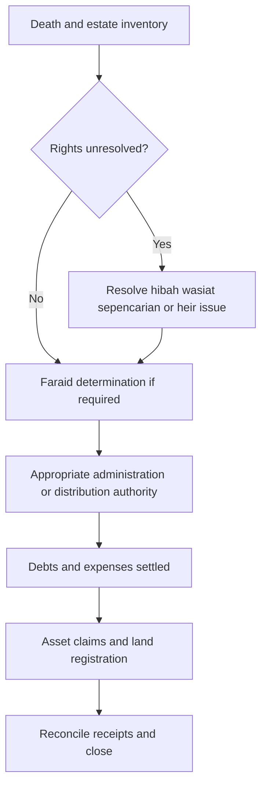
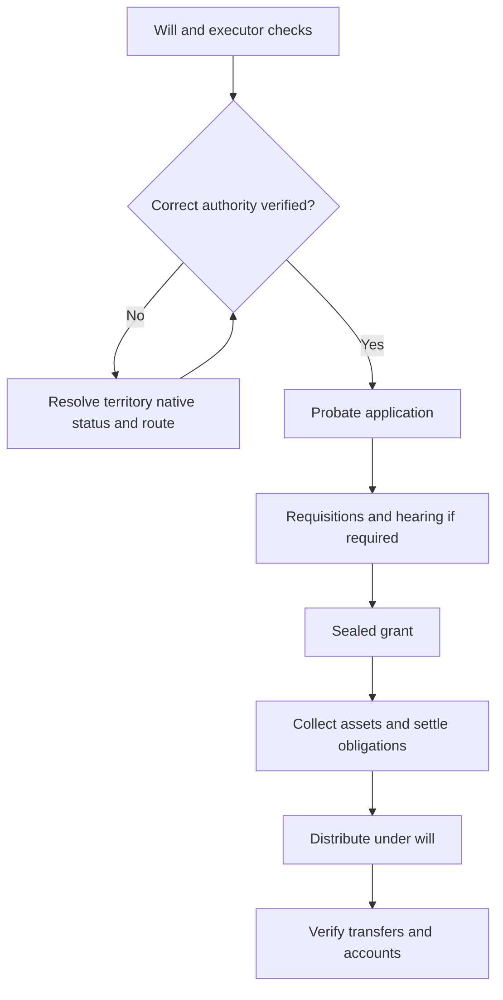
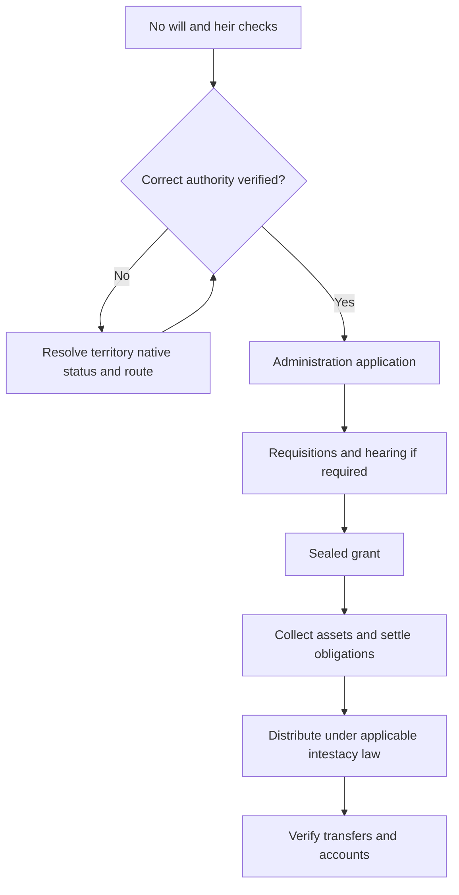
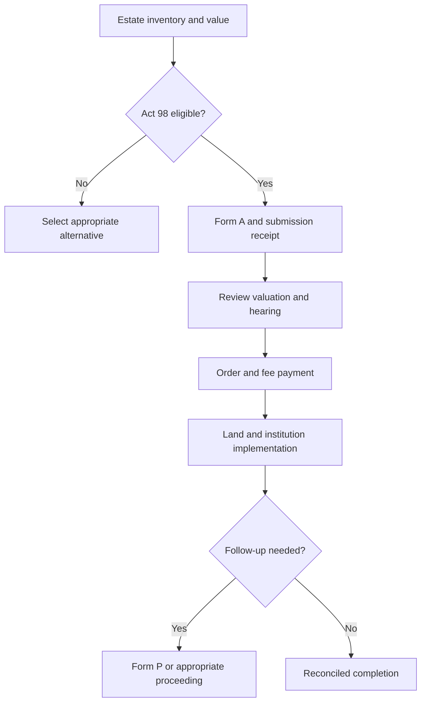

# Labuan — Inheritance Process Workflow

## 1. Overview

Research cutoff and access date: **2026-10-11**. **FACT** means supported by the cited material; it does not certify that no later amendment exists. **INFERENCE** means proposed workflow/design reasoning. **UNKNOWN** means **Not found / needs verification**, with the office named. Older schedules, indexed-only evidence and service targets are identified explicitly.

FACT: The federal small-estate, ARB and civil-court routes must be separated from Islamic entitlement determination. A 2020 Labuan High Court judgment applies the Probate and Administration Ordinance Cap. 109. This conflicts with generic web advice treating Act 97 as automatically operative in every Federal Territory. Act 98 has a Labuan modification and an official Labuan estate-office listing. INFERENCE: Labuan needs its own civil-law commencement review, alongside the shared MSWP religious route. [labuan7] [labuan8] [labuan9]

The comparison skeleton is the local PDF’s **Prepare → Route → File → Review/hearing → Grant/order → Transfers**. These are product stages, not statutory percentages or a promise of elapsed time. This file maps all four requested case types; the “small estate” branch overlaps religion/will status rather than forming a fourth religion category.

## 2. Applicable Law and Authorities

| Law/Enactment | Applies to | Authority in charge |
| --- | --- | --- |
| Administration of Islamic Law (Federal Territories) Act 1993 (Act 505), particularly s50; Syariah Court Civil Procedure (Federal Territories) Act 1998 (Act 585) | Muslim entitlement, religious proceedings and Baitulmal functions; check current amendments | Mahkamah Syariah Wilayah Persekutuan (MSWP), Labuan; Majlis Agama Islam Wilayah Persekutuan (MAIWP) (distinct roles; local sources below) |
| Probate and Administration Ordinance Cap. 109; Act 97 commencement must be checked | Civil representation; 2020 Labuan judgment applies the ordinance | High Court in Sabah and Sarawak, Labuan registry [labuan7] [labuan11] |
| Labuan Native Title Act 2007 (Act 667), including s16 | Native holdings; restrictions on non-native representatives | PTGWP Labuan / competent native-title authority [labuan10] |
| Act 98 with Labuan modifications, including P.U.(A) 20/2011 | Small estates in Labuan | Labuan estate office/Registrar of Titles as applicable [labuan8] [N27] |
| Public Trust Corporation Act 1995 (Act 532) | ARB summary powers where applicable and broader administration services | Amanah Raya Berhad; other grant authority when required [N5] [N6] |
| Stamp Act 1949 and RPGT Act 1976 | Instruments, inherited-property tax treatment and later disposals | HASiL; land registry checks registrability [N19] [N20] [N21] |
| EPF legislation, product terms and nomination rules; insurance/takaful legislation | Asset-specific death payments and nominee capacity | KWSP/EPF, ASNB, Tabung Haji, banks and insurers; these institutions do not replace the estate authority [N10] [N12] [N14] [N17] |

JPN supplies death/identity records; JPPH or a qualified valuer may supply valuation; creditors establish liabilities. Religious departments/councils, Syariah courts, civil courts and land offices perform different functions. No state religious council is assumed to issue a civil probate grant.

## 3. Process Flow by Case Type

### Muslim

FACT: MSWP’s current checklist uses case code 311, notice MS3 and affidavit MS26, with two typed sets and supporting documents. Residence confirmation is required when the applicant’s identification address is outside the court’s territory. The checklist expressly sends Labuan cases above RM50,000 to the Syariah High Court; this is not the small-estate value ceiling. UNKNOWN: current complete fee and certificate-processing target. [labuan1] [labuan2]

1. **Establish the estate and competing rights.** Actor: applicant and prospective representative. Submit: death, family tree at each death, property interests, debts, marriage and any hibah/wasiat/sepencarian evidence. Form: intake inventory; state-specific claim forms if adjudication is needed. Fee: document/search costs; local adjudication fees unknown. Typical duration: document-dependent; no verified statewide median. Output: estate boundary and unresolved-rights list. [N25]
2. **Obtain Islamic entitlement determination when required.** Actor: Mahkamah Syariah Wilayah Persekutuan (MSWP), Labuan. Submit: application, deaths, heir identities/relationships, asset evidence, residence and witnesses required by the registry. Form: local faraid pack described above; do not reuse another state’s form. Fee: see section 5; unknown items require registry assessment. Typical duration: local target above if applicable; otherwise Not found / needs verification with the receiving office. Output: sealed certificate/order, or directions to resolve missing evidence. [N9]
3. **Secure authority to administer.** Actor: Labuan estate office/competent civil registry after territorial verification. Submit: verified estate inventory, any required faraid/sepencarian orders and representative evidence. Form: the relevant small-estate, ARB or civil/local application below. Fee: route-specific; see section 5. Typical duration: route-specific; certificate time is not added as an assumed fixed delay. Output: distribution order or authority naming the person entitled to collect/administer.
4. **Settle obligations and implement distribution.** Actor: authorised representative, creditors, asset holders, land registry and, only where it has a relevant role, Majlis Agama Islam Wilayah Persekutuan (MAIWP). Submit: sealed authority, asset-specific claim packs, valid debt/expense evidence and tax documents. Form: institution forms and local land instrument; see sections 4–5. Fee: institution/registration/stamping/service charges assessed separately. Typical duration: asset-dependent; Not found / needs verification with the receiving office. Output: receipts, registered titles, protected minor shares and beneficiary acknowledgements. [N10] [N12] [N14] [N18]

A faraid certificate establishes entitlement; the receiving institution must confirm whether it also accepts the particular order as release authority. Sabah/Sarawak institution exceptions are addressed in the shared asset protocol. Baitulmal is a conditional claimant/administrator/redemption party, not a mandatory processing counter for every Muslim estate. [N13]

### Non-Muslim with will

FACT: The Labuan judgment reviewed applies Cap. 109; current civil-registry confirmation is a routing prerequisite. Do not assume Act 97 or Distribution Act 1958 merely from Federal Territory status. [labuan7] [labuan11]

1. **Confirm route and applicant.** Actor: executor named in the will. Submit: death evidence, original will/codicils and executor availability, inventory, domicile and foreign/native issues. Form: pre-filing inventory and registry checklist. Fee: search/copy/advice costs; Not found / needs verification with the receiving office. Typical duration: no verified local median. Output: selected authority and applicant; unresolved eligibility flagged. [labuan7]
2. **Lodge representation application.** Actor: High Court in Sabah and Sarawak, Labuan registry, or competent local/native route after screening. Submit: death/identity, asset and liability schedule, will and evidence of execution; renunciation or substitution evidence where needed. Form: Cap. 109 petition/affidavit and current probate-registry pack; exact current identifiers Not found / needs verification with the receiving office. Fee: Not found / needs verification with the receiving office. Typical duration: filing acceptance and requisition time Not found / needs verification with the receiving office. Output: case number and accepted papers or deficiency notice. [labuan7]
3. **Satisfy inquiries and obtain grant.** Actor: applicant/representative and deciding authority. Submit: responses, originals, attendance and execution evidence where required. Form: registry directions, oath/affidavit, probate grant. Fee: court/grant/certified-copy charges Not found / needs verification with the receiving office. Typical duration: no verified 2026 local median; disputes may require separate proceedings. Output: sealed grant and asset schedule or reasoned further directions. [labuan7]
4. **Administer and transfer.** Actor: appointed executor/administrator. Submit: grant, debts/expenses/tax information and institution-specific documents. Form: claims and land registration forms in sections 4–5. Fee: not included in the filing fee; see section 5. Typical duration: depends on each asset and creditor issue; Not found / needs verification with the receiving office. Output: estate accounts and evidenced transfers; distribute under the valid will subject to applicable law and unresolved claims. [labuan7]

### Non-Muslim without will

FACT: The Labuan judgment reviewed applies Cap. 109; current civil-registry confirmation is a routing prerequisite. Do not assume Act 97 or Distribution Act 1958 merely from Federal Territory status. [labuan7] [labuan11]

1. **Confirm route and applicant.** Actor: person seeking appointment as administrator. Submit: death evidence, heir tree, absence-of-will enquiries, representative priority/consents, inventory, domicile and foreign/native issues. Form: pre-filing inventory and registry checklist. Fee: search/copy/advice costs; Not found / needs verification with the receiving office. Typical duration: no verified local median. Output: selected authority and applicant; unresolved eligibility flagged. [labuan7]
2. **Lodge representation application.** Actor: High Court in Sabah and Sarawak, Labuan registry, or competent local/native route after screening. Submit: death/identity, asset and liability schedule, heir/relationship evidence, consents or renunciations, proposed administrator and security/guardian documents if required. Form: Cap. 109 petition/affidavit and current probate-registry pack; exact current identifiers Not found / needs verification with the receiving office. Fee: Not found / needs verification with the receiving office. Typical duration: filing acceptance and requisition time Not found / needs verification with the receiving office. Output: case number and accepted papers or deficiency notice. [labuan7]
3. **Satisfy inquiries and obtain grant.** Actor: applicant/representative and deciding authority. Submit: responses, originals, attendance and any required administration bond/sureties or dispensation request. Form: registry directions, oath/affidavit, letters of administration. Fee: court/grant/certified-copy charges Not found / needs verification with the receiving office. Typical duration: no verified 2026 local median; disputes may require separate proceedings. Output: sealed grant and asset schedule or reasoned further directions. [labuan7]
4. **Administer and transfer.** Actor: appointed executor/administrator. Submit: grant, debts/expenses/tax information and institution-specific documents. Form: claims and land registration forms in sections 4–5. Fee: not included in the filing fee; see section 5. Typical duration: depends on each asset and creditor issue; Not found / needs verification with the receiving office. Output: estate accounts and evidenced transfers; distribute under the applicable local succession/customary law; Labuan law requires registry verification. [labuan7]

For an eligible smaller estate, replace the High Court filing/grant steps with the small-estate or accepted ARB steps below; do not file duplicate administration cases.

### Small estate

FACT: The current federal ceiling is **not exceeding RM5 million at application**, including movable-only, immovable-only and mixed estates; a non-Muslim will changes routing. Labuan’s Act 98 modifications and local office assignment must also be checked. [labuan8] [N27] [N28] The current JKPTG FAQ and March 2026 MyGovernment guidance corroborate the ceiling. [N1] [N2]

1. **Apply.** Actor: eligible heir/interested applicant to Labuan estate office under the applicable local arrangements. Submit: death, heirs, title/search, assets and debts. Form: Form A under s8; confirm Labuan’s current MyLand/local intake channel and retain submission receipt; follow office instructions for sworn/original papers. Fee: order fee assessed later; incidental oath/search/copy costs separate. Typical duration: preparation variable; office acceptance not a fixed published stage SLA. Output: submission reference and office allocation. [N1] [N3]
2. **Review and hearing.** Actor: estate distribution officer, applicant, heirs and witnesses as directed. Submit: original evidence, valuation and attendance/valid consent. Form: notice D/S; DDA for a non-attending consenting heir where accepted; guardian attendance where required. Fee: no separate uniform hearing price verified. Typical duration: JKPTG publishes 4–6 months overall processing, subject to backlog; not a hearing-only or land-release target. Output: finding of heirs, estate and lawful distribution; adjournment if incomplete. [N1] [N2]
3. **Order and assessed fee.** Actor: deciding officer and payer. Submit: approved distribution/admin particulars and payment. Form: applicable E/F/T/HH or other issued order; verify legal effect. Fee: JKPTG FAQ: 0.2% below RM2 million; 0.3% RM2,000,001–RM5 million; exact boundary/rounding requires schedule confirmation. Typical duration: do not turn the PDF’s 30 days into an unconditional 2026 SLA. Output: sealed order plus fee receipt. [N1]
4. **Implement or reopen.** Actor: named representative/beneficiaries, land office and asset institutions. Submit: order, original title as required, identity and each claim pack. Form: registration/claim forms; Form P s17 for appropriate subsequent matters. Fee: land/institution/stamp charges additional. Typical duration: asset-specific; Not found / needs verification with the receiving office. Output: registered ownership, money released and reconciled; subsequent application if omitted asset or other qualifying follow-up. [N1] [N3]

### Amanah Raya branch and overlapping routes

FACT: The national summary-estate guide describes movable-only estates up to RM600,000. ARB also acts as administrator/executor and can obtain authority through other routes; those wider services are not capped at RM600,000. The authority is statutory/representative authority, not a power of attorney from a deceased person. UNKNOWN: confirm the statutory basis and local-asset acceptance with the Labuan branch before treating this national summary threshold as an independently sufficient local route. [N5] [N6]

1. **Open ARB file.** Actor: applicant and ARB. Submit: identity/death, relationships, asset/liability proof, will if any. Form: current ARB estate-administration form and checklist. Fee: written administration quotation needed; do not reuse 2019 fee bands as current. Typical duration: file completeness dependent; no current local median. Output: accepted engagement and verified service route. [N26] [N31]
2. **Investigate, obtain authority and distribute.** Actor: ARB with courts/estate authority if needed. Submit: verified values, heirs, debts and requisite entitlement orders. Form: statutory declaration/direction or court/local grant appropriate to the case. Fee: service quote plus disbursements and other authority fees. Typical duration: ARB describes three months to years generally; not a jurisdiction-specific SLA. Output: authority, collection/distribution accounts and payment evidence. [N5] [N6]

### Land transmission after any route

FACT: PTGWP publishes separate Labuan fee columns and representative-registration forms. Select the Labuan application, not an identically titled form for another territory. The table lists RM50 for representative-registration applications; it does not establish the full cost of every beneficiary transmission. Labuan requires native-title screening under Act 667 as well as the applicable modified land law. UNKNOWN: current per-title charging basis, estate-order registration fee and completion time. [labuan3] [labuan6]

INFERENCE: Track (a) registry/checklist selected, (b) representative registration where required, (c) beneficiary vesting/transfer or authorised sale, (d) registration accepted, and (e) updated title/search received. An administrator entered on the register is not necessarily the final beneficiary. Verify stamp classification, encumbrances and any required sale/vesting authority before generating the next instrument.

FACT: Labuan’s land framework also needs the applicable NLC extension/modification and Act 667 native-title provisions. The current PTGWP table uses NLC forms, but the particular legacy/native title and appropriate recipient must be checked by PTGWP Labuan. [labuan3] [labuan10]

## 4. Required Documents Checklist

The following is a preparation checklist, not a substitute for the receiving office’s dated checklist. Keep originals, certified copies and ordinary uploads as distinct requirements; copy counts vary. [N3] [N6] [N9]

| Case type | Documents to gather | Conditional additions / verification |
| --- | --- | --- |
| All cases | Death certificate/accepted death order; deceased and applicant ID/passport; heirs’ ICs/birth records; marriage/divorce/adoption or other relationship proof; contact/residence details; asset inventory, ownership fractions, title/search and bank/investment statements; liabilities and funeral expenses | Death evidence for predeceased/intermediate heirs; missing-person order; name/IC discrepancy proof; translations/legalisation for foreign records; original-title availability |
| Muslim | All common documents; state faraid application/affidavit; complete family tree as at each death; asset values | Wasiat/hibah/trust documents; sepencarian pleadings/orders; witnesses; residence evidence; minor guardian/trustee authority; Baitulmal entitlement/redemption papers only where relevant |
| Non-Muslim with will | Common documents plus original will and codicils, executor identity and execution evidence requested by registry | Executor death/renunciation/substitution; will annexed administration; foreign grant/recognition; disputed validity; local native-law compatibility |
| Non-Muslim without will | Common documents, full heir tree, proposed administrator, consents/renunciations and estate schedule | Bond/sureties or dispensation if required; minor/life-interest protections; native/customary proof where applicable |
| Small estate | Form A, death/heir/asset evidence and relevant originals; DDA when an absent heir validly consents | Previous order plus Form P for appropriate subsequent application; guardianship evidence, valuation and title restrictions [N1] [N3] |

FACT: The MSWP checklist requires two typed sets, MS3/MS26 and relevant residence/death/supporting evidence. Historical eFaST material describes accelerated simple cases; current Labuan branch availability is unknown. [labuan1] [N30]

### Institution-specific claims intersecting this estate

The detailed common protocol, including nomination exceptions and evidence gates, is in [README — Asset claims](README.md#asset-claims). It applies here subject to the local grant-recognition checks below.

| Asset / actor | Submission and form | Estate intersection / output |
| --- | --- | --- |
| KWSP / EPF (same institution) | Death/claimant identity, bank details, nomination or representative/relationship proof; KWSP 9KM (AHL) and current checklist | Muslim nominee generally acts as wasi; non-Muslim nominee generally as beneficiary. Record nomination date/status and actual payment; do not automatically exclude Muslim nominated savings [N10] [N11] |
| ASNB / ASB | Estate claim T1 with death, identity, relationship and accepted authority; hibah-amanah claim uses its separate pack | Simplified route at ≤RM10,000 subject to conditions; higher claims ordinarily require recognised authority. Faraid-only acceptance differs for qualifying Sabah/Sarawak orders; obtain ASNB confirmation [N12] [N13] |
| Tabung Haji | JP005; JP006 where indemnity/consent applies; JP035 for relevant hibah claim; supporting death/ID/account/authority | Nomination/hibah/no-nomination are separate paths. THiJARI has eligibility limits; branch handling remains for excluded cases [N14] [N15] [N16] |
| Banks | Bank’s own claim instructions, death/ID and accepted grant/order; title of estate account if required | Maybank Malaysia terms recognise probate/LA or equivalent legal authority. Bank release does not decide disputed beneficial ownership or universal joint-account survivorship [N18] |
| Life insurance / takaful | Insurer claim form, death/policy/ID, nominee capacity, medical/police evidence if requested; grant where needed | Check beneficiary, executor nominee, trust, assignment or conditional hibah status. No universal rule excludes all policies from the estate; the takaful operator’s form distinguishes beneficiary from executor [N17] [N34] |

UNKNOWN: institution-specific fees and actual release times for this jurisdiction were not found; verify with the claim unit holding the asset. Nomination/hibah validation and institution acceptance must be logged per asset, not assumed from religion alone.

Labuan financial-centre insurance/trust products need their own governing-law check. Act 704 contains specific policy-payment provisions; domestic FSA/IFSA assumptions cannot simply be copied onto every Labuan product. [labuan12]

## 5. Fees and Timelines Summary

FACT: PTGWP’s indexed table lists RM50 representative-registration application; official/private search columns are RM30/RM50. These items are not an all-inclusive inheritance charge. UNKNOWN: 2026 tariff confirmation and MSWP faraid fee. [labuan3]

| Stage / charge | Amount or basis | Duration / evidence status |
| --- | --- | --- |
| Preparation, copies, searches, oaths | Itemised supplier/registry charges; not a single estate fee | Applicant-dependent; no verified local median |
| Syariah application and certificate | Local published item above where found; otherwise Not found / needs verification with court registry | Local target above only if eligibility met; otherwise unknown |
| JKPTG order (eligible Act 98 case) | Published 0.2% below RM2m; 0.3% RM2,000,001–RM5m; boundary/rounding verification required [N1] | Published overall processing 4–6 months, backlog dependent; excludes later releases [N1] |
| ARB administration | Written quotation + disbursements; historical schedules not current quotes [N5] [N31] | ARB general description: 3 months to years; not a local promise [N5] |
| Civil probate / LA | Current registry filing/grant fees, certified copies and any security; legal fees separate | Not found / needs verification with competent registry |
| Land registration | Local transaction/title-specific fee described above, otherwise unknown | Registration clock begins on acceptable complete instruments, not death date |
| Stamp duty | Qualifying beneficiary transfers/renunciations may attract RM10; not every sale, assignment or family arrangement qualifies [N21] | Assess instrument, consideration, recipient and operative law; keep stamp certificate |
| Asset releases | Institution-specific charges; no universal claim fee | Not found / needs verification with each claim unit |

FACT: HASiL distinguishes executor and beneficiary acquisition dates/values for inherited real property; do not apply the death-date market value to every later beneficiary sale. Stamp self-assessment is phased from 2026, so select the correct instrument category and current channel. Estate duty’s abolition is not an exemption from all stamp, income-tax or RPGT obligations. See the [shared fee and tax notes](README.md#fees-and-tax). [N19] [N20]

## 6. Digital Channels Available Today

FACT: MSWP publishes forms and service information; PTGWP eTanah distinguishes KL, Putrajaya and Labuan. MyLand supports the federal small-estate system, but confirm the office-assigned channel for this case. UNKNOWN: public electronic faraid filing scope and external APIs. [labuan1] [labuan2] [labuan6] [N1]

FACT: EPF nomination/account services, THiJARI eligible claims and institution websites provide separate digital functions. Their existence does not prove that every death claim can be completed online. [N11] [N16]

UNKNOWN: No documented public estate-submission/status API or authorised MyEG inheritance integration was established in this research. INFERENCE: initially use deep links, downloadable packs and user-uploaded receipts. Pursue agency-approved integrations separately; label imported/user-reported statuses by provenance. Manual originals, oaths, attendance and registrability checks remain tasks unless the receiving authority expressly accepts a digital substitute.

FACT: MyGovernment’s March 2026 guidance describes eSyariah V3 case-status/appointment functions nationally except Sarawak. UNKNOWN: coverage of the specific faraid case and local account eligibility; no end-to-end filing or public API is implied. [N33]

## 7. Pain Points and Bottlenecks

INFERENCE from the authority/document boundaries above; no measured state delay statistics were found:

- Incorrect office or instrument selection causes rejection; an entitlement certificate and representation authority serve different purposes.
- Successive deaths, absent heirs, incomplete marriages/adoptions and inconsistent IDs create evidence gaps before shares can be finalised.
- An omitted asset, disputed hibah/will, encumbrance, restricted title or minor’s share may need a linked proceeding or supplemental authority.
- A sealed grant can coexist with unreleased bank funds or unregistered land; a grant date alone cannot mean completion.
- Old RM2m pages, historical fee sheets and generic court charters can produce false prices or deadlines.

Confirm MSWP fees, current registry allocation and the 2026 faraid rules’ gazettal/commencement; verify PTGWP tariff and complete transmission checklist. Priority: establish current Cap. 109/Act 97 and intestacy-law applicability with the Labuan High Court registry; obtain Act 667 native-title route and current Act 98 local intake instructions.

## 8. Differences from the Baseline PDF Workflow

| PDF skeleton / proposition | Result for this jurisdiction |
| --- | --- |
| Prepare → Route → File → Review/hearing → Grant → Transfers (pp. 5–9) | Same useful product skeleton; add local authority, evidence and exception tasks rather than change progress by elapsed days |
| Peninsular/FT scope and excluded Sabah/Sarawak (pp. 1–2) | Labuan requires its own civil-law/native-title checks despite the PDF’s broad FT scope |
| RM5m small estate and RM600k movable summary branch (pp. 2–3) | Current national ceiling corroborated; these overlapping routes are eligibility checks, not automatic appointment of two administrators |
| Faraid, wasiat and hibah (pp. 2, 5–6) | Certificate conditional on need; lifetime hibah is not simply a one-third wasiat; separate title/validity disputes and obligations from share calculation |
| Nominated assets / insurance / joint assets (pp. 2, 11–13) | Correct the blanket exclusion: nominee capacity, product terms and actual beneficial interest matter; Muslim EPF nomination does not remove distribution duties |
| Court route whenever complex or disputed; lawyer mandatory (pp. 3, 8) | Complexity requires review, not an automatic jurisdiction switch; verify the competent proceedings and representation requirements |
| RM10 stamping and inherited-property tax shortcut (pp. 11–13) | Instrument-specific stamp treatment and different executor/beneficiary acquisition rules; no universal RM10 total |
| Form A/P, orders and 30-day operational instructions (pp. 6–9) | Use the current pack and office directions; universal hardcopy/order-issue deadlines were not independently established |
| Evidence-based completion; missed assets reopen (pp. 4, 9–13) | Preserve; record each release/title and use the legally appropriate supplemental process |

Local differences to carry into the PDF-derived skeleton: FACT: MSWP’s current checklist uses case code 311, notice MS3 and affidavit MS26, with two typed sets and supporting documents. Residence confirmation is required when the applicant’s identification address is outside the court’s territory. The checklist expressly sends Labuan cases above RM50,000 to the Syariah High Court; this is not the small-estate value ceiling. UNKNOWN: current complete fee and certificate-processing target. [labuan1] [labuan2] FACT: PTGWP publishes separate Labuan fee columns and representative-registration forms. Select the Labuan application, not an identically titled form for another territory. The table lists RM50 for representative-registration applications; it does not establish the full cost of every beneficiary transmission. Labuan requires native-title screening under Act 667 as well as the applicable modified land law. UNKNOWN: current per-title charging basis, estate-order registration fee and completion time. [labuan3] [labuan6]

## 9. App Design Implications

INFERENCE — proposed product rules, not agency requirements:

- Use the [unified status model](README.md#unified-status-model) with separate entitlement, authority and per-asset workstreams. Do not hard-code the PDF’s 15/10/15/20/15/25 weights as legal progress.
- Capture religion at death; domicile/residence; death sequence; citizenship/native status; asset jurisdiction and title category; will/executor; nomination date and capacity; ownership fraction; values with valuation date; debts; heirs alive at each death; guardian/trustee; disputes and prior case numbers.
- Store the issuing authority, order scope, legal provision/form version, fee source/effective date, submitted/accepted dates, responsible actor, evidence and next action. “Submitted” requires a receipt; “accepted” requires authority acknowledgement.
- Treat calculators as drafts and keep judicially established shares separately. Block automated routing where operative law, native/customary status or local registry allocation is unresolved.
- Target MyLand, Syariah registry, land portal, ARB and asset-holder partnerships only after obtaining integration documentation and permission. No API availability is asserted.
- Store beneficiary receipt and updated-title evidence; reconcile liabilities and undistributed balances. A reopened asset should preserve the previous completion history.

FACT: A 2020 Labuan High Court judgment applies the Probate and Administration Ordinance Cap. 109. This conflicts with generic web advice treating Act 97 as automatically operative in every Federal Territory. Act 98 has a Labuan modification and an official Labuan estate-office listing. INFERENCE: Labuan needs its own civil-law commencement review, alongside the shared MSWP religious route. [labuan7] [labuan8] [labuan9]

## 10. Confidence and Gaps

Confidence describes the evidence retrieved, not a legal guarantee. **High** = current primary support for the specified proposition; **Medium** = supported architecture with incomplete local operational detail; **Low** = significant missing/currentness/territorial issues.

| Section | Confidence | Reason |
| --- | --- | --- |
| 1. Overview | Low | Local distinctions supported; unresolved scope is explicit |
| 2. Applicable Law and Authorities | Low | Principal framework identified; current consolidated amendments/commencement not exhaustively verified |
| 3. Process Flow by Case Type | Low | Stages supported; some local forms, fees and routing gates remain unknown |
| 4. Required Documents Checklist | Medium | Preparation checklist plus published institution rules; local originals/copy requirements vary |
| 5. Fees and Timelines Summary | Low | Many current local amounts and observed durations unavailable; targets are qualified |
| 6. Digital Channels Available Today | Medium | Published entry points found; live transaction/API capability not tested |
| 7. Pain Points and Bottlenecks | Medium | Explicit workflow inference, not measured delay statistics |
| 8. Differences from the Baseline PDF Workflow | High | PDF read in full; mapped against identified rules and gaps |
| 9. App Design Implications | Medium | Design proposals depend on unresolved agency interfaces |
| 10. Confidence and Gaps | High | Known limitations explicitly recorded |
| 11. Sources | Medium | Primary sources preferred; indexed-only and historical sources disclosed |

Open questions and verification owner: Confirm MSWP fees, current registry allocation and the 2026 faraid rules’ gazettal/commencement; verify PTGWP tariff and complete transmission checklist. Priority: establish current Cap. 109/Act 97 and intestacy-law applicability with the Labuan High Court registry; obtain Act 667 native-title route and current Act 98 local intake instructions.

Recent reform check: the RM5m/movable-only reform is reflected in current JKPTG guidance. JKPTG also announces cancellation of old estate circulars effective 13 January 2026; replacement instructions must be checked before reviving an old procedural requirement. [N1] [N22]

FACT: JAKIM reported drafting Federal Territories faraid rules in March 2026. UNKNOWN: later gazettal/commencement; do not treat the drafting meeting as operative law. [labuan5]

No absence-of-reform claim is made: failure to locate a later instrument is recorded as an open question. A second independent current source was not found for most local fee items; the sources list makes this limitation reviewable.

## 11. Sources

Local baseline read in full: [project description](../estate-unlock-project.md) and [14-page workflow PDF](../PDF/Malaysia%20estate%20unlock%20complete%20case%20workflow.pdf), accessed 2026-10-11. The supplied PDF is a comparison baseline, not independent legal authority.

- **N1 — JKPTG: current small-estate FAQ.** <https://www.jkptg.gov.my/my/47-faq/pusaka-kecil/1084-pusaka-kecil>. Accessed 2026-10-11. Primary source; consulted online.
- **N2 — MyGovernment: small-estate procedure, updated 13 March 2026.** <https://www.malaysia.gov.my/my/categories/death--inheritance/division-of-inheritance/small-inheritance-application-procedure>. Accessed 2026-10-11. Primary source; consulted online.
- **N3 — JKPTG: application documents and subsequent applications.** <https://www.jkptg.gov.my/my/11-artikel/918-pembahagian-harta-pusaka>. Accessed 2026-10-11. Primary source; consulted online.
- **N5 — Amanah Raya: estate administration.** <https://www.amanahraya.my/services/estate-administration/>. Accessed 2026-10-11. Primary source; consulted online.
- **N6 — MyGovernment: summary-estate application, March 2026.** <https://www.malaysia.gov.my/my/topics/prosedur-permohonan-pusaka-ringkas>. Accessed 2026-10-11. Primary source; consulted online.
- **N9 — JKSM: faraid application FAQ.** <https://www.faraid.gov.my/Faraid/lazim.do>. Accessed 2026-10-11. Generic guidance; its fee and five-day figures are NOT treated as universal state rules.
- **N10 — EPF: death withdrawal.** <https://www.kwsp.gov.my/en/member/account-centre/death>. Accessed 2026-10-11. Primary source; consulted online.
- **N11 — EPF: nomination.** <https://www.kwsp.gov.my/en/member/account-centre/nomination>. Accessed 2026-10-11. Primary source; consulted online.
- **N12 — ASNB: estate-claim brochure, October 2025.** <https://www.asnb.com.my/v2/pdf/borang/2025oct/brosur_tuntutanharta.pdf>. Accessed 2026-10-11. Primary source; consulted online.
- **N13 — ASNB: estate-claim FAQ.** <https://new-corp.myasnb.com.my/V2/asnbv2_5faq_EN.php>. Accessed 2026-10-11. Primary source; consulted online.
- **N14 — Tabung Haji: withdrawal and account closure.** <https://tabunghaji.gov.my/bm/pengeluaran-dan-penutupan-akaun>. Accessed 2026-10-11. Primary source; consulted online.
- **N15 — Tabung Haji: JP005 death claim form.** <https://assets.tabunghaji.gov.my/uploads/BORANG_JP_005_e7fb9c80cc.pdf>. Accessed 2026-10-11. Primary source; consulted online.
- **N16 — Tabung Haji: THiJARI FAQ.** <https://www.tabunghaji.gov.my/bm/soalan-lazim/thijari>. Accessed 2026-10-11. Primary source; consulted online.
- **N17 — LIAM: nomination FAQ.** <https://www.liam.org.my/images/liam/FAQ%20on%20Making%20A%20Nomination-f.pdf>. Accessed 2026-10-11. Insurance-industry primary guidance; policy and governing statute must also be checked.
- **N18 — Maybank Malaysia: conventional account terms.** <https://www.maybank2u.com.my/iwov-resources/pdf/personal/tnc/governBankAcc-Conv.pdf>. Accessed 2026-10-11. Bank-specific terms, not a nationwide bank-claim SLA.
- **N19 — HASiL: inherited real-property transfers and RPGT.** <https://www.hasil.gov.my/en/ckht/pindah-milik-harta-tanah-yang-dipusakai/>. Accessed 2026-10-11. Primary source; consulted online.
- **N20 — HASiL: stamp-duty self-assessment rollout.** <https://www.hasil.gov.my/en/duti-setem/sistem-taksir-sendiri-duti-setem-stsds/>. Accessed 2026-10-11. Primary source; consulted online.
- **N21 — Finance (No. 2) Act 2023, Customs official mirror.** <https://mysst.customs.gov.my/assets/document/SST%20Act/Finance%20%28No.%202%29%20Act%202023.pdf>. Accessed 2026-10-11. Enacted amendment identified in official indexed text; direct PDF fetch failed; later 2026 consolidation not fully audited.
- **N22 — JKPTG: cancellation of old estate circulars, effective 13 January 2026.** <https://www.jkptg.gov.my/en/sumber/arkib/arkib-pengumuman/1854-hebahan-pekeliling-kptg-bil-1-2025-pembatalan-pekeliling-pekeliling-dalam-pengurusan-harta-pusaka-kecil>. Accessed 2026-10-11. Announcement opened; complete attachment-by-attachment replacement audit remains outstanding.
- **N25 — MyGovernment: preliminary steps for Muslim estates.** <https://www.malaysia.gov.my/en/topics/important-things-before-dividing-inheritance-for-muslims>. Accessed 2026-10-11. Primary source; consulted online.
- **N26 — Amanah Raya: forms.** <https://www.amanahraya.my/resources/forms/>. Accessed 2026-10-11. Primary source; consulted online.
- **N27 — Small Estates Act, official historical mirror.** <https://ptg.melaka.gov.my/storage/UNDANG-UNDANG/8.%20Small%20Estates%20%28Distribution%29%20Act%201955%20%5BAct%2098%5D.pdf>. Accessed 2026-10-11. Historical consolidation: territorial modifications useful; old value limit is superseded.
- **N28 — Current Small Estates Act text, secondary mirror.** <https://mylaw.my/legislation/small-estates-distribution-act-1955>. Accessed 2026-10-11. Secondary legal mirror; corroborates A1643 commencement and Labuan modification; official current text fetch unavailable.
- **N30 — MSWP published innovation/service glossary, 2023.** <https://www.mswp.gov.my/admin/uploads/publications/20230405153919.pdf>. Accessed 2026-10-11. Historical eFaST two-hour objective for eligible simple cases; current branch availability not established.
- **N31 — Amanah Raya estate checklist, 2019 version.** <https://www.amanahraya.my/wp-content/uploads/2023/08/ESTATE_Senarai-Semakan-PHP0001B2S52019.pdf>. Accessed 2026-10-11. Historical thresholds/targets/fee bands, not a 2026 quotation.
- **N33 — MyGovernment: Syariah registration and eSyariah V3, March 2026.** <https://www.malaysia.gov.my/my/topics/prosedur-pendaftaran-kes-di-mahkamah-syariah>. Accessed 2026-10-11. Official indexed guidance; direct fetch returned 403; general service coverage, not proof of every case-specific online function.
- **N34 — Takaful Malaysia nomination form, 2024 version.** <https://www.takaful-malaysia.com.my/wp-content/uploads/2024/07/NOMINATION-FORM-FOR-INDIVIDUAL-FAMILY-CERTIFICATE.pdf>. Accessed 2026-10-11. Operator primary form; distinguishes conditional-hibah beneficiary from executor.
- **labuan1 — MSWP current faraid checklist, November 2024.** <https://www.mswp.gov.my/uploads/content-downloads/file_20241106124742.pdf>. Accessed 2026-10-11. Primary source; consulted online.
- **labuan2 — MSWP service coverage.** <https://www.mswp.gov.my/portal-main/home>. Accessed 2026-10-11. Primary source; consulted online.
- **labuan3 — PTGWP forms and territorial fee columns.** <https://www.ptgwp.gov.my/portal/muat-turun-borang>. Accessed 2026-10-11. Official indexed table; direct fetch rejected; confirm current gazetted tariff.
- **labuan4 — MAIWP faraid and estate service.** <https://www.maiwp.gov.my/portal-main/article2?bg=false&id=faraid-pusaka>. Accessed 2026-10-11. Primary source; consulted online.
- **labuan5 — JAKIM: Federal Territories faraid rules being drafted, March 2026.** <https://www.islam.gov.my/en/berita/4992-terima-kasih-pengarah-bahagian-pengurusan-perundangan-tanah-jabatan-ketua-pengarah-tanah-dan-galian-putrajaya>. Accessed 2026-10-11. Primary source; consulted online.
- **labuan6 — PTGWP eTanah court-vesting manual.** <https://www.ptgwp.gov.my/portal/documents/d/guest/phmm-perletakhakan-oleh-mahkamah>. Accessed 2026-10-11. Primary source; consulted online.
- **labuan7 — Lee You Hiong v Liau Leong Tiam, Labuan High Court judgment (2020).** <https://supremetoday.ai/doc/judgement/MYS00000005373>. Accessed 2026-10-11. Secondary reproduction of judgment; official docket corroborates case, full official judgment retrieval still needed.
- **labuan8 — JKPTG 2023 land-administration journal: Labuan and Act 98.** <https://www.jkptg.gov.my/images/pdf/jurnal-pentadbiran/LAND_JURNAL_BIL_6_TAHUN_2023.pdf>. Accessed 2026-10-11. Primary source; consulted online.
- **labuan9 — JKPTG Labuan estate-office listing.** <https://www.jkptg.gov.my/my/2-uncategorised>. Accessed 2026-10-11. Primary source; consulted online.
- **labuan10 — Labuan Native Title Act 2007, s16.** <https://lawplayer.com/my/article/act-667/s-16>. Accessed 2026-10-11. Secondary statutory transcription; verify official consolidation and title-specific application.
- **labuan11 — Official judiciary docket: Lee You Hiong case.** <https://ekss-cmsa.kehakiman.gov.my/apps/ekss_sbh/cap/judgments/view_ajax/%26search_case%3D%26search_year%3D%26judge_id%3D761%26crtcat%3D1?crtcat=1&judge_id=761&page=12&search_case=&search_year=&sort=>. Accessed 2026-10-11. Primary source; consulted online.
- **labuan12 — Labuan Financial Services and Securities Act 2010.** <https://www.labuanfsa.gov.my/clients/asset_120A5FB8-61B6-45E8-93F0-3F79F86455C8/contentms/img/documents/Legislation_and_Guidelines/Legislation/Principal_Legislation/Labuan-Financial-Services-and-Securities-Act-2010-Act-704.pdf>. Accessed 2026-10-11. Primary source; consulted online.

[N1]: https://www.jkptg.gov.my/my/47-faq/pusaka-kecil/1084-pusaka-kecil
[N2]: https://www.malaysia.gov.my/my/categories/death--inheritance/division-of-inheritance/small-inheritance-application-procedure
[N3]: https://www.jkptg.gov.my/my/11-artikel/918-pembahagian-harta-pusaka
[N5]: https://www.amanahraya.my/services/estate-administration/
[N6]: https://www.malaysia.gov.my/my/topics/prosedur-permohonan-pusaka-ringkas
[N9]: https://www.faraid.gov.my/Faraid/lazim.do
[N10]: https://www.kwsp.gov.my/en/member/account-centre/death
[N11]: https://www.kwsp.gov.my/en/member/account-centre/nomination
[N12]: https://www.asnb.com.my/v2/pdf/borang/2025oct/brosur_tuntutanharta.pdf
[N13]: https://new-corp.myasnb.com.my/V2/asnbv2_5faq_EN.php
[N14]: https://tabunghaji.gov.my/bm/pengeluaran-dan-penutupan-akaun
[N15]: https://assets.tabunghaji.gov.my/uploads/BORANG_JP_005_e7fb9c80cc.pdf
[N16]: https://www.tabunghaji.gov.my/bm/soalan-lazim/thijari
[N17]: https://www.liam.org.my/images/liam/FAQ%20on%20Making%20A%20Nomination-f.pdf
[N18]: https://www.maybank2u.com.my/iwov-resources/pdf/personal/tnc/governBankAcc-Conv.pdf
[N19]: https://www.hasil.gov.my/en/ckht/pindah-milik-harta-tanah-yang-dipusakai/
[N20]: https://www.hasil.gov.my/en/duti-setem/sistem-taksir-sendiri-duti-setem-stsds/
[N21]: https://mysst.customs.gov.my/assets/document/SST%20Act/Finance%20%28No.%202%29%20Act%202023.pdf
[N22]: https://www.jkptg.gov.my/en/sumber/arkib/arkib-pengumuman/1854-hebahan-pekeliling-kptg-bil-1-2025-pembatalan-pekeliling-pekeliling-dalam-pengurusan-harta-pusaka-kecil
[N25]: https://www.malaysia.gov.my/en/topics/important-things-before-dividing-inheritance-for-muslims
[N26]: https://www.amanahraya.my/resources/forms/
[N27]: https://ptg.melaka.gov.my/storage/UNDANG-UNDANG/8.%20Small%20Estates%20%28Distribution%29%20Act%201955%20%5BAct%2098%5D.pdf
[N28]: https://mylaw.my/legislation/small-estates-distribution-act-1955
[N30]: https://www.mswp.gov.my/admin/uploads/publications/20230405153919.pdf
[N31]: https://www.amanahraya.my/wp-content/uploads/2023/08/ESTATE_Senarai-Semakan-PHP0001B2S52019.pdf
[N33]: https://www.malaysia.gov.my/my/topics/prosedur-pendaftaran-kes-di-mahkamah-syariah
[N34]: https://www.takaful-malaysia.com.my/wp-content/uploads/2024/07/NOMINATION-FORM-FOR-INDIVIDUAL-FAMILY-CERTIFICATE.pdf
[labuan1]: https://www.mswp.gov.my/uploads/content-downloads/file_20241106124742.pdf
[labuan2]: https://www.mswp.gov.my/portal-main/home
[labuan3]: https://www.ptgwp.gov.my/portal/muat-turun-borang
[labuan4]: https://www.maiwp.gov.my/portal-main/article2?bg=false&id=faraid-pusaka
[labuan5]: https://www.islam.gov.my/en/berita/4992-terima-kasih-pengarah-bahagian-pengurusan-perundangan-tanah-jabatan-ketua-pengarah-tanah-dan-galian-putrajaya
[labuan6]: https://www.ptgwp.gov.my/portal/documents/d/guest/phmm-perletakhakan-oleh-mahkamah
[labuan7]: https://supremetoday.ai/doc/judgement/MYS00000005373
[labuan8]: https://www.jkptg.gov.my/images/pdf/jurnal-pentadbiran/LAND_JURNAL_BIL_6_TAHUN_2023.pdf
[labuan9]: https://www.jkptg.gov.my/my/2-uncategorised
[labuan10]: https://lawplayer.com/my/article/act-667/s-16
[labuan11]: https://ekss-cmsa.kehakiman.gov.my/apps/ekss_sbh/cap/judgments/view_ajax/%26search_case%3D%26search_year%3D%26judge_id%3D761%26crtcat%3D1?crtcat=1&judge_id=761&page=12&search_case=&search_year=&sort=
[labuan12]: https://www.labuanfsa.gov.my/clients/asset_120A5FB8-61B6-45E8-93F0-3F79F86455C8/contentms/img/documents/Legislation_and_Guidelines/Legislation/Principal_Legislation/Labuan-Financial-Services-and-Securities-Act-2010-Act-704.pdf
