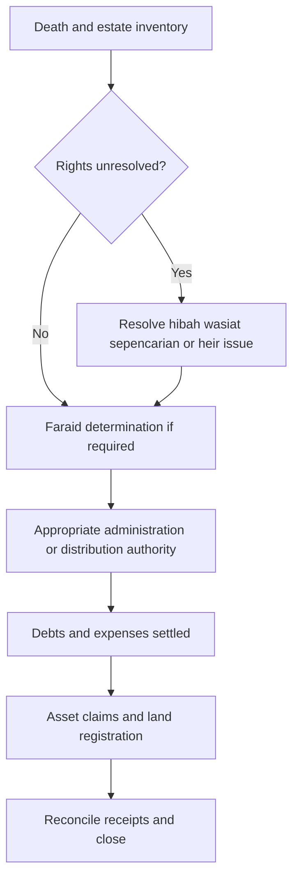
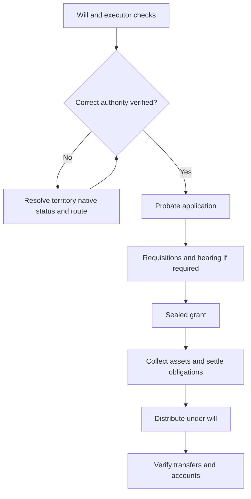
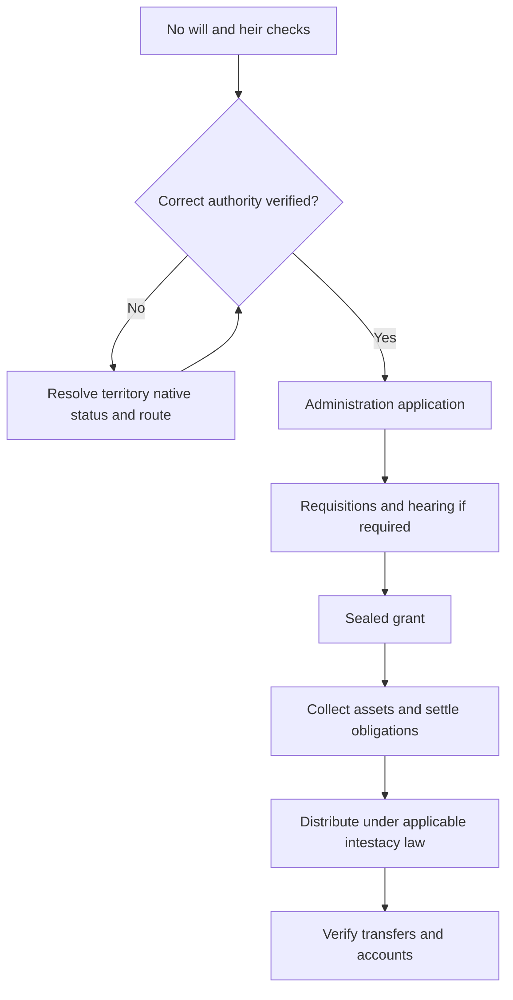
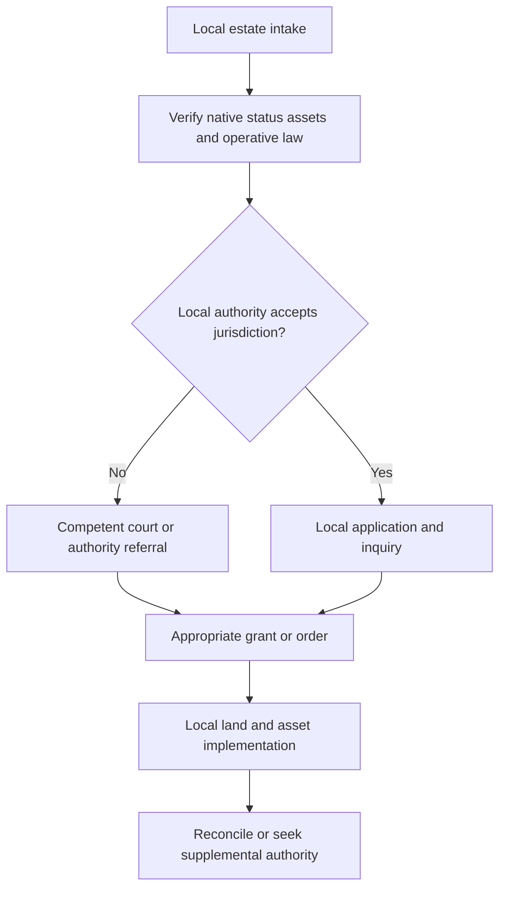

# Sabah — Inheritance Process Workflow

## 1. Overview

Research cutoff and access date: **2026-10-11**. **FACT** means supported by the cited material; it does not certify that no later amendment exists. **INFERENCE** means proposed workflow/design reasoning. **UNKNOWN** means **Not found / needs verification**, with the office named. Older schedules, indexed-only evidence and service targets are identified explicitly.

FACT: This jurisdiction needs a local-law route rather than the PDF’s Peninsular template. The Sabah law index expressly marks the federal repeal of the native/small-estate and probate ordinances as not in force. Non-Muslim non-native intestacy uses the Intestate Succession Ordinance 1960; its exclusions require a separate Muslim/native branch. Baitulmal’s official FAQ describes its estate-receipt role. INFERENCE: law commencement, native status and asset location must be blocking routing fields. [sabah6] [sabah7] [sabah9]

The comparison skeleton is the local PDF’s **Prepare → Route → File → Review/hearing → Grant/order → Transfers**. These are product stages, not statutory percentages or a promise of elapsed time. This file maps all four requested case types; the “small estate” branch overlaps religion/will status rather than forming a fourth religion category.

## 2. Applicable Law and Authorities

| Law/Enactment | Applies to | Authority in charge |
| --- | --- | --- |
| Syariah Courts Enactment 2004; Majlis Ugama Islam Negeri Sabah Enactment 2004; Baitulmal Corporation Enactment 1998; Muslim succession reform passed in July 2026, commencement unverified | Muslim entitlement, religious proceedings and Baitulmal functions; check current amendments | Jabatan Kehakiman Syariah Negeri Sabah; Perbadanan Baitulmal Negeri Sabah; MUIS for its respective religious functions (distinct roles; local sources below) |
| Act 97 / Act 98 federal extensions | Do not equate enacted extension with operative local commencement | Confirm local ordinance and commencement with the competent registry; see local sources |
| Probate and Administration Ordinance (Cap. 109); Wills Ordinance (Cap. 158) | Applicable civil probate/administration and wills; check exclusions | High Court in Sabah and Sarawak, Sabah registry [sabah6] |
| Administration of Native and Small Estates Ordinance (Cap. 1), Forms and Fees Rules 1953; native-court legislation | Local native/small-estate route, eligibility to verify | District Collector/native authorities [sabah4] [sabah6] [sabah10] |
| Intestate Succession Ordinance 1960 | Non-Muslim non-native intestacy within its scope | Civil/local estate authority [sabah7] |
| Land Ordinance (Cap. 68) | Sabah land and native-title restrictions | JTU / district land office [sabah4] |
| Public Trust Corporation Act 1995 (Act 532) | ARB summary powers where applicable and broader administration services | Amanah Raya Berhad; other grant authority when required [N5] [N6] |
| Stamp Act 1949 and RPGT Act 1976 | Instruments, inherited-property tax treatment and later disposals | HASiL; land registry checks registrability [N19] [N20] [N21] |
| EPF legislation, product terms and nomination rules; insurance/takaful legislation | Asset-specific death payments and nominee capacity | KWSP/EPF, ASNB, Tabung Haji, banks and insurers; these institutions do not replace the estate authority [N10] [N12] [N14] [N17] |

JPN supplies death/identity records; JPPH or a qualified valuer may supply valuation; creditors establish liabilities. Religious departments/councils, Syariah courts, civil courts and land offices perform different functions. No state religious council is assumed to issue a civil probate grant.

## 3. Process Flow by Case Type

### Muslim

FACT: Sabah’s court service pages offer heir-confirmation and estate-administration/distribution case types, not merely a calculator. Obtain the precise Syariah order required by the receiving institution. Reports dated 22 July 2026 say the Muslim Succession and Native Courts bills passed. UNKNOWN: gazetted text, commencement, transitional cases and implementing forms; passage alone must not activate a new routing rule. [sabah1] [sabah2] [sabah3]

1. **Establish the estate and competing rights.** Actor: applicant and prospective representative. Submit: death, family tree at each death, property interests, debts, marriage and any hibah/wasiat/sepencarian evidence. Form: intake inventory; state-specific claim forms if adjudication is needed. Fee: document/search costs; local adjudication fees unknown. Typical duration: document-dependent; no verified statewide median. Output: estate boundary and unresolved-rights list. [N25]
2. **Obtain Islamic entitlement determination when required.** Actor: Jabatan Kehakiman Syariah Negeri Sabah. Submit: application, deaths, heir identities/relationships, asset evidence, residence and witnesses required by the registry. Form: local faraid pack described above; do not reuse another state’s form. Fee: see section 5; unknown items require registry assessment. Typical duration: local target above if applicable; otherwise Not found / needs verification with the receiving office. Output: sealed certificate/order, or directions to resolve missing evidence. [N9]
3. **Secure authority to administer.** Actor: the local Collector/native route or competent High Court, after the 2026 commencement check. Submit: verified estate inventory, any required faraid/sepencarian orders and representative evidence. Form: the relevant small-estate, ARB or civil/local application below. Fee: route-specific; see section 5. Typical duration: route-specific; certificate time is not added as an assumed fixed delay. Output: distribution order or authority naming the person entitled to collect/administer.
4. **Settle obligations and implement distribution.** Actor: authorised representative, creditors, asset holders, land registry and, only where it has a relevant role, Perbadanan Baitulmal Negeri Sabah; MUIS for its respective religious functions. Submit: sealed authority, asset-specific claim packs, valid debt/expense evidence and tax documents. Form: institution forms and local land instrument; see sections 4–5. Fee: institution/registration/stamping/service charges assessed separately. Typical duration: asset-dependent; Not found / needs verification with the receiving office. Output: receipts, registered titles, protected minor shares and beneficiary acknowledgements. [N10] [N12] [N14] [N18]

A faraid certificate establishes entitlement; the receiving institution must confirm whether it also accepts the particular order as release authority. Sabah/Sarawak institution exceptions are addressed in the shared asset protocol. Baitulmal is a conditional claimant/administrator/redemption party, not a mandatory processing counter for every Muslim estate. [N13]

### Non-Muslim with will

FACT: Sabah’s statutory index retains Cap. 109 pending federal commencement. Native/customary jurisdiction requires a separate screen. [sabah6]

1. **Confirm route and applicant.** Actor: executor named in the will. Submit: death evidence, original will/codicils and executor availability, inventory, domicile and foreign/native issues. Form: pre-filing inventory and registry checklist. Fee: search/copy/advice costs; Not found / needs verification with the receiving office. Typical duration: no verified local median. Output: selected authority and applicant; unresolved eligibility flagged. [sabah6]
2. **Lodge representation application.** Actor: High Court in Sabah and Sarawak, appropriate Sabah registry, or competent local/native route after screening. Submit: death/identity, asset and liability schedule, will and evidence of execution; renunciation or substitution evidence where needed. Form: Cap. 109 petition/affidavit and current probate-registry pack; exact current identifiers Not found / needs verification with the receiving office. Fee: Not found / needs verification with the receiving office. Typical duration: filing acceptance and requisition time Not found / needs verification with the receiving office. Output: case number and accepted papers or deficiency notice. [sabah6]
3. **Satisfy inquiries and obtain grant.** Actor: applicant/representative and deciding authority. Submit: responses, originals, attendance and execution evidence where required. Form: registry directions, oath/affidavit, probate grant. Fee: court/grant/certified-copy charges Not found / needs verification with the receiving office. Typical duration: no verified 2026 local median; disputes may require separate proceedings. Output: sealed grant and asset schedule or reasoned further directions. [sabah6]
4. **Administer and transfer.** Actor: appointed executor/administrator. Submit: grant, debts/expenses/tax information and institution-specific documents. Form: claims and land registration forms in sections 4–5. Fee: not included in the filing fee; see section 5. Typical duration: depends on each asset and creditor issue; Not found / needs verification with the receiving office. Output: estate accounts and evidenced transfers; distribute under the valid will subject to applicable law and unresolved claims. [sabah6]

### Non-Muslim without will

FACT: Sabah’s statutory index retains Cap. 109 pending federal commencement. Native/customary jurisdiction requires a separate screen. [sabah6]

1. **Confirm route and applicant.** Actor: person seeking appointment as administrator. Submit: death evidence, heir tree, absence-of-will enquiries, representative priority/consents, inventory, domicile and foreign/native issues. Form: pre-filing inventory and registry checklist. Fee: search/copy/advice costs; Not found / needs verification with the receiving office. Typical duration: no verified local median. Output: selected authority and applicant; unresolved eligibility flagged. [sabah6]
2. **Lodge representation application.** Actor: High Court in Sabah and Sarawak, appropriate Sabah registry, or competent local/native route after screening. Submit: death/identity, asset and liability schedule, heir/relationship evidence, consents or renunciations, proposed administrator and security/guardian documents if required. Form: Cap. 109 petition/affidavit and current probate-registry pack; exact current identifiers Not found / needs verification with the receiving office. Fee: Not found / needs verification with the receiving office. Typical duration: filing acceptance and requisition time Not found / needs verification with the receiving office. Output: case number and accepted papers or deficiency notice. [sabah6]
3. **Satisfy inquiries and obtain grant.** Actor: applicant/representative and deciding authority. Submit: responses, originals, attendance and any required administration bond/sureties or dispensation request. Form: registry directions, oath/affidavit, letters of administration. Fee: court/grant/certified-copy charges Not found / needs verification with the receiving office. Typical duration: no verified 2026 local median; disputes may require separate proceedings. Output: sealed grant and asset schedule or reasoned further directions. [sabah6]
4. **Administer and transfer.** Actor: appointed executor/administrator. Submit: grant, debts/expenses/tax information and institution-specific documents. Form: claims and land registration forms in sections 4–5. Fee: not included in the filing fee; see section 5. Typical duration: depends on each asset and creditor issue; Not found / needs verification with the receiving office. Output: estate accounts and evidenced transfers; distribute under the Sabah Intestate Succession Ordinance for covered non-native cases, or applicable native law. [sabah6]

### Small estate

FACT: The Peninsular MyLand/RM5 million route is not the local small-estate regime established by the sources reviewed. Sabah retains the native/small-estates ordinance route; its current monetary and category limits need direct verification. [sabah4] [sabah6]

1. **Determine local eligibility.** Actor: applicant and district Collector/native authority. Submit: death, religion/native status, asset locations, values and prior proceedings. Form: local eligibility enquiry; statutory category and ceiling Not found / needs verification with the receiving office. Fee: Not found / needs verification with the receiving office. Typical duration: Not found / needs verification with the receiving office. Output: recorded local authority decision; no automatic RM5 million classification. [sabah4] [sabah6] [sabah10]
2. **File local application.** Actor: district Collector/native authority. Submit: estate inventory, heir and relationship proof, any will and consents, community/native evidence where required. Form: current local prescribed pack; 1953 Forms and Fees Rules identified, current Form 1 applicability to confirm. Fee: Not found / needs verification with the receiving office. Typical duration: Not found / needs verification with the receiving office. Output: accepted case and inquiry/hearing directions. [sabah4] [sabah6] [sabah10]
3. **Inquiry and decision.** Actor: district Collector/native authority and any court to which the matter is referred. Submit: originals, witness/community evidence, entitlement and debt information. Form: local order/grant and notices; identifiers to verify. Fee: Not found / needs verification with the receiving office. Typical duration: Not found / needs verification with the receiving office. Output: valid local distribution/representation instrument or referral. [sabah4] [sabah6] [sabah10]
4. **Execute the local instrument.** Actor: representative, land office and asset holders. Submit: recognised order/grant and institution-specific evidence. Form: local land and asset claim forms, not automatically NLC/MyLand forms. Fee: see local fee notes; otherwise Not found / needs verification with the receiving office. Typical duration: Not found / needs verification with the receiving office. Output: registered/released assets and reconciled accounts. [sabah4] [sabah6] [sabah10]

### Amanah Raya branch and overlapping routes

FACT: The national summary-estate guide describes movable-only estates up to RM600,000. ARB also acts as administrator/executor and can obtain authority through other routes; those wider services are not capped at RM600,000. The authority is statutory/representative authority, not a power of attorney from a deceased person. UNKNOWN: confirm the statutory basis and local-asset acceptance with the Sabah branch before treating this national summary threshold as an independently sufficient local route. [N5] [N6]

1. **Open ARB file.** Actor: applicant and ARB. Submit: identity/death, relationships, asset/liability proof, will if any. Form: current ARB estate-administration form and checklist. Fee: written administration quotation needed; do not reuse 2019 fee bands as current. Typical duration: file completeness dependent; no current local median. Output: accepted engagement and verified service route. [N26] [N31]
2. **Investigate, obtain authority and distribute.** Actor: ARB with courts/estate authority if needed. Submit: verified values, heirs, debts and requisite entitlement orders. Form: statutory declaration/direction or court/local grant appropriate to the case. Fee: service quote plus disbursements and other authority fees. Typical duration: ARB describes three months to years generally; not a jurisdiction-specific SLA. Output: authority, collection/distribution accounts and payment evidence. [N5] [N6]

### Land transmission after any route

FACT: Sabah uses its Land Ordinance, not the ordinary Peninsular NLC transmission template. JTU identifies the Administration of Native and Small Estates Ordinance as relevant. Its published land-fee schedule distinguishes succession-order registration (RM30, RM10 for each additional title) from court probate-order registration (RM100, RM50 for each additional title). UNKNOWN: 2026 amendments, exact transaction eligibility and whether another presentation charge applies. Native title/recipient status needs JTU and, where relevant, native-court confirmation. [sabah4] [sabah5]

INFERENCE: Track (a) registry/checklist selected, (b) representative registration where required, (c) beneficiary vesting/transfer or authorised sale, (d) registration accepted, and (e) updated title/search received. An administrator entered on the register is not necessarily the final beneficiary. Verify stamp classification, encumbrances and any required sale/vesting authority before generating the next instrument.

## 4. Required Documents Checklist

The following is a preparation checklist, not a substitute for the receiving office’s dated checklist. Keep originals, certified copies and ordinary uploads as distinct requirements; copy counts vary. [N3] [N6] [N9]

| Case type | Documents to gather | Conditional additions / verification |
| --- | --- | --- |
| All cases | Death certificate/accepted death order; deceased and applicant ID/passport; heirs’ ICs/birth records; marriage/divorce/adoption or other relationship proof; contact/residence details; asset inventory, ownership fractions, title/search and bank/investment statements; liabilities and funeral expenses | Death evidence for predeceased/intermediate heirs; missing-person order; name/IC discrepancy proof; translations/legalisation for foreign records; original-title availability |
| Muslim | All common documents; state faraid application/affidavit; complete family tree as at each death; asset values | Wasiat/hibah/trust documents; sepencarian pleadings/orders; witnesses; residence evidence; minor guardian/trustee authority; Baitulmal entitlement/redemption papers only where relevant |
| Non-Muslim with will | Common documents plus original will and codicils, executor identity and execution evidence requested by registry | Executor death/renunciation/substitution; will annexed administration; foreign grant/recognition; disputed validity; local native-law compatibility |
| Non-Muslim without will | Common documents, full heir tree, proposed administrator, consents/renunciations and estate schedule | Bond/sureties or dispensation if required; minor/life-interest protections; native/customary proof where applicable |
| Local smaller/native estate | Current district/local application, sworn inventory, heir/community evidence and existing grants/orders | Confirm applicable local form, native status, notice/witness rules and whether there are prior proceedings; do not use Form A/DDA automatically |

### Institution-specific claims intersecting this estate

The detailed common protocol, including nomination exceptions and evidence gates, is in [README — Asset claims](README.md#asset-claims). It applies here subject to the local grant-recognition checks below.

| Asset / actor | Submission and form | Estate intersection / output |
| --- | --- | --- |
| KWSP / EPF (same institution) | Death/claimant identity, bank details, nomination or representative/relationship proof; KWSP 9KM (AHL) and current checklist | Muslim nominee generally acts as wasi; non-Muslim nominee generally as beneficiary. Record nomination date/status and actual payment; do not automatically exclude Muslim nominated savings [N10] [N11] |
| ASNB / ASB | Estate claim T1 with death, identity, relationship and accepted authority; hibah-amanah claim uses its separate pack | Simplified route at ≤RM10,000 subject to conditions; higher claims ordinarily require recognised authority. Faraid-only acceptance differs for qualifying Sabah/Sarawak orders; obtain ASNB confirmation [N12] [N13] |
| Tabung Haji | JP005; JP006 where indemnity/consent applies; JP035 for relevant hibah claim; supporting death/ID/account/authority | Nomination/hibah/no-nomination are separate paths. THiJARI has eligibility limits; branch handling remains for excluded cases [N14] [N15] [N16] |
| Banks | Bank’s own claim instructions, death/ID and accepted grant/order; title of estate account if required | Maybank Malaysia terms recognise probate/LA or equivalent legal authority. Bank release does not decide disputed beneficial ownership or universal joint-account survivorship [N18] |
| Life insurance / takaful | Insurer claim form, death/policy/ID, nominee capacity, medical/police evidence if requested; grant where needed | Check beneficiary, executor nominee, trust, assignment or conditional hibah status. No universal rule excludes all policies from the estate; the takaful operator’s form distinguishes beneficiary from executor [N17] [N34] |

UNKNOWN: institution-specific fees and actual release times for this jurisdiction were not found; verify with the claim unit holding the asset. Nomination/hibah validation and institution acceptance must be logged per asset, not assumed from religion alone.

## 5. Fees and Timelines Summary

FACT: Published JTU schedule contains distinct succession/court-order fees; single-source figures require current counter confirmation. UNKNOWN: current Cap. 1 small-estate value ceiling, petition/court/faraid fees, hearing notices and end-to-end processing time. Do not substitute RM5 million or a historical RM20,000 figure. [sabah5] [sabah6]

| Stage / charge | Amount or basis | Duration / evidence status |
| --- | --- | --- |
| Preparation, copies, searches, oaths | Itemised supplier/registry charges; not a single estate fee | Applicant-dependent; no verified local median |
| Syariah application and certificate | Local published item above where found; otherwise Not found / needs verification with court registry | Local target above only if eligibility met; otherwise unknown |
| Local probate / native / smaller-estate order | Not found / needs verification with Probate Officer or Collector/court; no imported JKPTG percentage | No verified local end-to-end SLA |
| ARB administration | Written quotation + disbursements; historical schedules not current quotes [N5] [N31] | ARB general description: 3 months to years; not a local promise [N5] |
| Civil probate / LA | Current registry filing/grant fees, certified copies and any security; legal fees separate | Not found / needs verification with competent registry |
| Land registration | Local transaction/title-specific fee described above, otherwise unknown | Registration clock begins on acceptable complete instruments, not death date |
| Stamp duty | Qualifying beneficiary transfers/renunciations may attract RM10; not every sale, assignment or family arrangement qualifies [N21] | Assess instrument, consideration, recipient and operative law; keep stamp certificate |
| Asset releases | Institution-specific charges; no universal claim fee | Not found / needs verification with each claim unit |

FACT: HASiL distinguishes executor and beneficiary acquisition dates/values for inherited real property; do not apply the death-date market value to every later beneficiary sale. Stamp self-assessment is phased from 2026, so select the correct instrument category and current channel. Estate duty’s abolition is not an exemption from all stamp, income-tax or RPGT obligations. See the [shared fee and tax notes](README.md#fees-and-tax). [N19] [N20]

## 6. Digital Channels Available Today

FACT: Sabah Syariah publishes civil-case categories and forms; the Sabah/Sarawak judiciary has eKSS case-search services. UNKNOWN: public online lodgment for each local-estate/native route and external APIs. MyLand is not established as the local statutory estate route. [sabah1] [sabah2] [sabah8]

FACT: EPF nomination/account services, THiJARI eligible claims and institution websites provide separate digital functions. Their existence does not prove that every death claim can be completed online. [N11] [N16]

UNKNOWN: No documented public estate-submission/status API or authorised MyEG inheritance integration was established in this research. INFERENCE: initially use deep links, downloadable packs and user-uploaded receipts. Pursue agency-approved integrations separately; label imported/user-reported statuses by provenance. Manual originals, oaths, attendance and registrability checks remain tasks unless the receiving authority expressly accepts a digital substitute.

FACT: MyGovernment’s March 2026 guidance describes eSyariah V3 case-status/appointment functions nationally except Sarawak. UNKNOWN: coverage of the specific faraid case and local account eligibility; no end-to-end filing or public API is implied. [N33]

## 7. Pain Points and Bottlenecks

INFERENCE from the authority/document boundaries above; no measured state delay statistics were found:

- Incorrect office or instrument selection causes rejection; an entitlement certificate and representation authority serve different purposes.
- Successive deaths, absent heirs, incomplete marriages/adoptions and inconsistent IDs create evidence gaps before shares can be finalised.
- An omitted asset, disputed hibah/will, encumbrance, restricted title or minor’s share may need a linked proceeding or supplemental authority.
- A sealed grant can coexist with unreleased bank funds or unregistered land; a grant date alone cannot mean completion.
- Old RM2m pages, historical fee sheets and generic court charters can produce false prices or deadlines.

Priority: obtain the 2026 Muslim Succession and Native Courts gazettes and commencement notices from Sabah AGC/court registries. Verify Cap. 1 jurisdiction/threshold and Forms/Fees Rules with the district Collector; confirm native-court vs Syariah overlap, Land Ordinance title restrictions and current JTU fees. Confirm ARB’s authority for each local asset before promising summary release.

## 8. Differences from the Baseline PDF Workflow

| PDF skeleton / proposition | Result for this jurisdiction |
| --- | --- |
| Prepare → Route → File → Review/hearing → Grant → Transfers (pp. 5–9) | Same useful product skeleton; add local authority, evidence and exception tasks rather than change progress by elapsed days |
| Peninsular/FT scope and excluded Sabah/Sarawak (pp. 1–2) | Different: this file supplies the local-law branches the PDF expressly defers; no automatic Act 97/98/NLC workflow |
| RM5m small estate and RM600k movable summary branch (pp. 2–3) | Do not transplant the RM5m route here; ARB authority must be confirmed for local assets |
| Faraid, wasiat and hibah (pp. 2, 5–6) | Certificate conditional on need; lifetime hibah is not simply a one-third wasiat; separate title/validity disputes and obligations from share calculation |
| Nominated assets / insurance / joint assets (pp. 2, 11–13) | Correct the blanket exclusion: nominee capacity, product terms and actual beneficial interest matter; Muslim EPF nomination does not remove distribution duties |
| Court route whenever complex or disputed; lawyer mandatory (pp. 3, 8) | Complexity requires review, not an automatic jurisdiction switch; verify the competent proceedings and representation requirements |
| RM10 stamping and inherited-property tax shortcut (pp. 11–13) | Instrument-specific stamp treatment and different executor/beneficiary acquisition rules; no universal RM10 total |
| Form A/P, orders and 30-day operational instructions (pp. 6–9) | Replace with the applicable local application/grant/land process; do not export these form labels |
| Evidence-based completion; missed assets reopen (pp. 4, 9–13) | Preserve; record each release/title and use the legally appropriate supplemental process |

Local differences to carry into the PDF-derived skeleton: FACT: Sabah’s court service pages offer heir-confirmation and estate-administration/distribution case types, not merely a calculator. Obtain the precise Syariah order required by the receiving institution. Reports dated 22 July 2026 say the Muslim Succession and Native Courts bills passed. UNKNOWN: gazetted text, commencement, transitional cases and implementing forms; passage alone must not activate a new routing rule. [sabah1] [sabah2] [sabah3] FACT: Sabah uses its Land Ordinance, not the ordinary Peninsular NLC transmission template. JTU identifies the Administration of Native and Small Estates Ordinance as relevant. Its published land-fee schedule distinguishes succession-order registration (RM30, RM10 for each additional title) from court probate-order registration (RM100, RM50 for each additional title). UNKNOWN: 2026 amendments, exact transaction eligibility and whether another presentation charge applies. Native title/recipient status needs JTU and, where relevant, native-court confirmation. [sabah4] [sabah5]

## 9. App Design Implications

INFERENCE — proposed product rules, not agency requirements:

- Use the [unified status model](README.md#unified-status-model) with separate entitlement, authority and per-asset workstreams. Do not hard-code the PDF’s 15/10/15/20/15/25 weights as legal progress.
- Capture religion at death; domicile/residence; death sequence; citizenship/native status; asset jurisdiction and title category; will/executor; nomination date and capacity; ownership fraction; values with valuation date; debts; heirs alive at each death; guardian/trustee; disputes and prior case numbers.
- Store the issuing authority, order scope, legal provision/form version, fee source/effective date, submitted/accepted dates, responsible actor, evidence and next action. “Submitted” requires a receipt; “accepted” requires authority acknowledgement.
- Treat calculators as drafts and keep judicially established shares separately. Block automated routing where operative law, native/customary status or local registry allocation is unresolved.
- Target MyLand, Syariah registry, land portal, ARB and asset-holder partnerships only after obtaining integration documentation and permission. No API availability is asserted.
- Store beneficiary receipt and updated-title evidence; reconcile liabilities and undistributed balances. A reopened asset should preserve the previous completion history.

FACT: The Sabah law index expressly marks the federal repeal of the native/small-estate and probate ordinances as not in force. Non-Muslim non-native intestacy uses the Intestate Succession Ordinance 1960; its exclusions require a separate Muslim/native branch. Baitulmal’s official FAQ describes its estate-receipt role. INFERENCE: law commencement, native status and asset location must be blocking routing fields. [sabah6] [sabah7] [sabah9]

## 10. Confidence and Gaps

Confidence describes the evidence retrieved, not a legal guarantee. **High** = current primary support for the specified proposition; **Medium** = supported architecture with incomplete local operational detail; **Low** = significant missing/currentness/territorial issues.

| Section | Confidence | Reason |
| --- | --- | --- |
| 1. Overview | Medium | Local distinctions supported; unresolved scope is explicit |
| 2. Applicable Law and Authorities | Medium | Principal framework identified; current consolidated amendments/commencement not exhaustively verified |
| 3. Process Flow by Case Type | Medium | Stages supported; some local forms, fees and routing gates remain unknown |
| 4. Required Documents Checklist | Medium | Preparation checklist plus published institution rules; local originals/copy requirements vary |
| 5. Fees and Timelines Summary | Low | Many current local amounts and observed durations unavailable; targets are qualified |
| 6. Digital Channels Available Today | Medium | Published entry points found; live transaction/API capability not tested |
| 7. Pain Points and Bottlenecks | Medium | Explicit workflow inference, not measured delay statistics |
| 8. Differences from the Baseline PDF Workflow | High | PDF read in full; mapped against identified rules and gaps |
| 9. App Design Implications | Medium | Design proposals depend on unresolved agency interfaces |
| 10. Confidence and Gaps | High | Known limitations explicitly recorded |
| 11. Sources | Medium | Primary sources preferred; indexed-only and historical sources disclosed |

Open questions and verification owner: Priority: obtain the 2026 Muslim Succession and Native Courts gazettes and commencement notices from Sabah AGC/court registries. Verify Cap. 1 jurisdiction/threshold and Forms/Fees Rules with the district Collector; confirm native-court vs Syariah overlap, Land Ordinance title restrictions and current JTU fees. Confirm ARB’s authority for each local asset before promising summary release.

No absence-of-reform claim is made: failure to locate a later instrument is recorded as an open question. A second independent current source was not found for most local fee items; the sources list makes this limitation reviewable.

## 11. Sources

Local baseline read in full: [project description](../estate-unlock-project.md) and [14-page workflow PDF](../PDF/Malaysia%20estate%20unlock%20complete%20case%20workflow.pdf), accessed 2026-10-11. The supplied PDF is a comparison baseline, not independent legal authority.

- **N3 — JKPTG: application documents and subsequent applications.** <https://www.jkptg.gov.my/my/11-artikel/918-pembahagian-harta-pusaka>. Accessed 2026-10-11. Primary source; consulted online.
- **N5 — Amanah Raya: estate administration.** <https://www.amanahraya.my/services/estate-administration/>. Accessed 2026-10-11. Primary source; consulted online.
- **N6 — MyGovernment: summary-estate application, March 2026.** <https://www.malaysia.gov.my/my/topics/prosedur-permohonan-pusaka-ringkas>. Accessed 2026-10-11. Primary source; consulted online.
- **N9 — JKSM: faraid application FAQ.** <https://www.faraid.gov.my/Faraid/lazim.do>. Accessed 2026-10-11. Generic guidance; its fee and five-day figures are NOT treated as universal state rules.
- **N10 — EPF: death withdrawal.** <https://www.kwsp.gov.my/en/member/account-centre/death>. Accessed 2026-10-11. Primary source; consulted online.
- **N11 — EPF: nomination.** <https://www.kwsp.gov.my/en/member/account-centre/nomination>. Accessed 2026-10-11. Primary source; consulted online.
- **N12 — ASNB: estate-claim brochure, October 2025.** <https://www.asnb.com.my/v2/pdf/borang/2025oct/brosur_tuntutanharta.pdf>. Accessed 2026-10-11. Primary source; consulted online.
- **N13 — ASNB: estate-claim FAQ.** <https://new-corp.myasnb.com.my/V2/asnbv2_5faq_EN.php>. Accessed 2026-10-11. Primary source; consulted online.
- **N14 — Tabung Haji: withdrawal and account closure.** <https://tabunghaji.gov.my/bm/pengeluaran-dan-penutupan-akaun>. Accessed 2026-10-11. Primary source; consulted online.
- **N15 — Tabung Haji: JP005 death claim form.** <https://assets.tabunghaji.gov.my/uploads/BORANG_JP_005_e7fb9c80cc.pdf>. Accessed 2026-10-11. Primary source; consulted online.
- **N16 — Tabung Haji: THiJARI FAQ.** <https://www.tabunghaji.gov.my/bm/soalan-lazim/thijari>. Accessed 2026-10-11. Primary source; consulted online.
- **N17 — LIAM: nomination FAQ.** <https://www.liam.org.my/images/liam/FAQ%20on%20Making%20A%20Nomination-f.pdf>. Accessed 2026-10-11. Insurance-industry primary guidance; policy and governing statute must also be checked.
- **N18 — Maybank Malaysia: conventional account terms.** <https://www.maybank2u.com.my/iwov-resources/pdf/personal/tnc/governBankAcc-Conv.pdf>. Accessed 2026-10-11. Bank-specific terms, not a nationwide bank-claim SLA.
- **N19 — HASiL: inherited real-property transfers and RPGT.** <https://www.hasil.gov.my/en/ckht/pindah-milik-harta-tanah-yang-dipusakai/>. Accessed 2026-10-11. Primary source; consulted online.
- **N20 — HASiL: stamp-duty self-assessment rollout.** <https://www.hasil.gov.my/en/duti-setem/sistem-taksir-sendiri-duti-setem-stsds/>. Accessed 2026-10-11. Primary source; consulted online.
- **N21 — Finance (No. 2) Act 2023, Customs official mirror.** <https://mysst.customs.gov.my/assets/document/SST%20Act/Finance%20%28No.%202%29%20Act%202023.pdf>. Accessed 2026-10-11. Enacted amendment identified in official indexed text; direct PDF fetch failed; later 2026 consolidation not fully audited.
- **N25 — MyGovernment: preliminary steps for Muslim estates.** <https://www.malaysia.gov.my/en/topics/important-things-before-dividing-inheritance-for-muslims>. Accessed 2026-10-11. Primary source; consulted online.
- **N26 — Amanah Raya: forms.** <https://www.amanahraya.my/resources/forms/>. Accessed 2026-10-11. Primary source; consulted online.
- **N31 — Amanah Raya estate checklist, 2019 version.** <https://www.amanahraya.my/wp-content/uploads/2023/08/ESTATE_Senarai-Semakan-PHP0001B2S52019.pdf>. Accessed 2026-10-11. Historical thresholds/targets/fee bands, not a 2026 quotation.
- **N33 — MyGovernment: Syariah registration and eSyariah V3, March 2026.** <https://www.malaysia.gov.my/my/topics/prosedur-pendaftaran-kes-di-mahkamah-syariah>. Accessed 2026-10-11. Official indexed guidance; direct fetch returned 403; general service coverage, not proof of every case-specific online function.
- **N34 — Takaful Malaysia nomination form, 2024 version.** <https://www.takaful-malaysia.com.my/wp-content/uploads/2024/07/NOMINATION-FORM-FOR-INDIVIDUAL-FAMILY-CERTIFICATE.pdf>. Accessed 2026-10-11. Operator primary form; distinguishes conditional-hibah beneficiary from executor.
- **sabah1 — Sabah Syariah civil-case classifications.** <https://sabah.jksm.gov.my/index.php/perkhidmatan/pendaftaran-kes/mal/pengkelasan-kes-mal>. Accessed 2026-10-11. Primary source; consulted online.
- **sabah2 — Sabah lower Syariah court forms.** <https://sabah.jksm.gov.my/mahkamah-rendah-syariah/>. Accessed 2026-10-11. Primary source; consulted online.
- **sabah3 — Bernama: Sabah succession and native-court bills, 22 July 2026.** <https://bernama.com/en/news.php?id=2584474>. Accessed 2026-10-11. Contemporaneous news report; does not establish commencement.
- **sabah4 — JTU statutory authority.** <https://jtu.sabah.gov.my/index.cfm?action=SOPAut&section=About>. Accessed 2026-10-11. Primary source; consulted online.
- **sabah5 — JTU Land Rules office fees.** <https://jtu.sabah.gov.my/Setup/Data/form/Land_Rules_15_Office_Fees.pdf>. Accessed 2026-10-11. Official indexed fee text; direct retrieval unsuccessful; amendments unverified.
- **sabah6 — Sabah AGC laws and commencement index.** <https://sagc.sabah.gov.my/?q=en/taxonomy/term/5/all>. Accessed 2026-10-11. Primary source; consulted online.
- **sabah7 — Sabah Intestate Succession Ordinance 1960.** <https://sagc.sabah.gov.my/sites/default/files/law/IntestateSuccessionOrdinance1960.pdf>. Accessed 2026-10-11. Primary source; consulted online.
- **sabah8 — Sabah/Sarawak judiciary case search.** <https://ekss-portal.kehakiman.gov.my/portals/web/home/list_search_case/>. Accessed 2026-10-11. Primary source; consulted online.
- **sabah9 — Sabah Baitulmal FAQ.** <https://baitulmal.sabah.gov.my/lazim.php>. Accessed 2026-10-11. Primary source; consulted online.
- **sabah10 — Sabah AGC subsidiary legislation index.** <https://sagc.sabah.gov.my/?q=ms/law-type/subsidiary-legislation-page>. Accessed 2026-10-11. Primary source; consulted online.
- **sabah11 — Daily Express: Muslim Succession Enactment passed.** <https://www.dailyexpress.com.my/news/285261/sabah-passes-muslim-succession-enactment-2026>. Accessed 2026-10-11. Secondary corroboration of passage; commencement remains unverified.

[N3]: https://www.jkptg.gov.my/my/11-artikel/918-pembahagian-harta-pusaka
[N5]: https://www.amanahraya.my/services/estate-administration/
[N6]: https://www.malaysia.gov.my/my/topics/prosedur-permohonan-pusaka-ringkas
[N9]: https://www.faraid.gov.my/Faraid/lazim.do
[N10]: https://www.kwsp.gov.my/en/member/account-centre/death
[N11]: https://www.kwsp.gov.my/en/member/account-centre/nomination
[N12]: https://www.asnb.com.my/v2/pdf/borang/2025oct/brosur_tuntutanharta.pdf
[N13]: https://new-corp.myasnb.com.my/V2/asnbv2_5faq_EN.php
[N14]: https://tabunghaji.gov.my/bm/pengeluaran-dan-penutupan-akaun
[N15]: https://assets.tabunghaji.gov.my/uploads/BORANG_JP_005_e7fb9c80cc.pdf
[N16]: https://www.tabunghaji.gov.my/bm/soalan-lazim/thijari
[N17]: https://www.liam.org.my/images/liam/FAQ%20on%20Making%20A%20Nomination-f.pdf
[N18]: https://www.maybank2u.com.my/iwov-resources/pdf/personal/tnc/governBankAcc-Conv.pdf
[N19]: https://www.hasil.gov.my/en/ckht/pindah-milik-harta-tanah-yang-dipusakai/
[N20]: https://www.hasil.gov.my/en/duti-setem/sistem-taksir-sendiri-duti-setem-stsds/
[N21]: https://mysst.customs.gov.my/assets/document/SST%20Act/Finance%20%28No.%202%29%20Act%202023.pdf
[N25]: https://www.malaysia.gov.my/en/topics/important-things-before-dividing-inheritance-for-muslims
[N26]: https://www.amanahraya.my/resources/forms/
[N31]: https://www.amanahraya.my/wp-content/uploads/2023/08/ESTATE_Senarai-Semakan-PHP0001B2S52019.pdf
[N33]: https://www.malaysia.gov.my/my/topics/prosedur-pendaftaran-kes-di-mahkamah-syariah
[N34]: https://www.takaful-malaysia.com.my/wp-content/uploads/2024/07/NOMINATION-FORM-FOR-INDIVIDUAL-FAMILY-CERTIFICATE.pdf
[sabah1]: https://sabah.jksm.gov.my/index.php/perkhidmatan/pendaftaran-kes/mal/pengkelasan-kes-mal
[sabah2]: https://sabah.jksm.gov.my/mahkamah-rendah-syariah/
[sabah3]: https://bernama.com/en/news.php?id=2584474
[sabah4]: https://jtu.sabah.gov.my/index.cfm?action=SOPAut&section=About
[sabah5]: https://jtu.sabah.gov.my/Setup/Data/form/Land_Rules_15_Office_Fees.pdf
[sabah6]: https://sagc.sabah.gov.my/?q=en/taxonomy/term/5/all
[sabah7]: https://sagc.sabah.gov.my/sites/default/files/law/IntestateSuccessionOrdinance1960.pdf
[sabah8]: https://ekss-portal.kehakiman.gov.my/portals/web/home/list_search_case/
[sabah9]: https://baitulmal.sabah.gov.my/lazim.php
[sabah10]: https://sagc.sabah.gov.my/?q=ms/law-type/subsidiary-legislation-page
[sabah11]: https://www.dailyexpress.com.my/news/285261/sabah-passes-muslim-succession-enactment-2026
